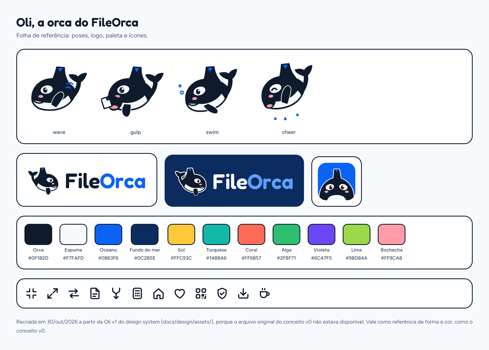
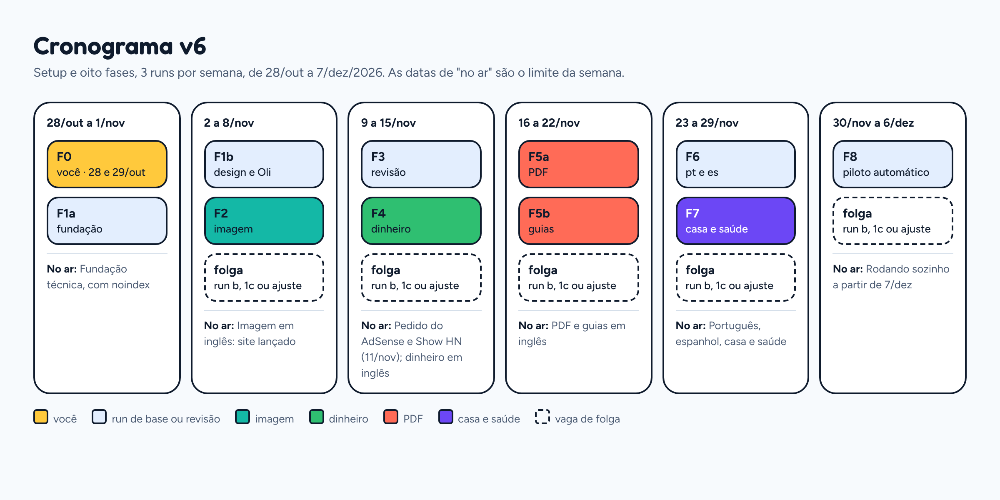

# Plano: FileOrca, ferramentas e calculadoras grátis monetizadas por anúncios

29/out/2026 · Victor Yuki Matusita · v7.1, versão de execução (substitui as v1 a v7) · plataforma na ADR-001 · design system v1.1 em DESIGN-SYSTEM.md

**O que mudou da v7 para a v7.1:** o design system passou ao v1.1 depois de uma revisão com axe, contraste e cálculo (lista em DESIGN-SYSTEM.md; a F1b aplica em docs/design/); o rótulo do anúncio em espanhol virou "Anuncios", que é o que o AdSense aceita; a linha do café no card de resultado não repete o "Done!" da Oli; o link de apoio fica só no rodapé (o cabeçalho não tem menu); a página /licenses cita as licenças certas; a folha da Oli troca 16 px por 32 px, e o ícone do app é que cobre o 16 px.

## Resumo

O FileOrca é um site só, o **fileorca.com**, com quatro áreas: ferramentas de arquivo (imagem e PDF), calculadoras de dinheiro, calculadoras de casa e saúde e utilidades. Tudo roda no navegador, em inglês, português e espanhol, sem conta, sem upload e sem servidor. A receita vem de anúncio (AdSense, depois Journey by Mediavine e Mediavine completo) e de doação voluntária (Ko-fi e Pix). O site é feito em vibe coding, em runs autônomas do Claude Code, e roda sozinho depois da F8.

O AdSense paga por impressão, e a impressão vale mais onde o anunciante disputa o público. Os arquivos trazem volume e as sessões Tier 1 que abrem o Journey; o hub de dinheiro, voltado aos EUA, sobe o RPM médio. Toda calculadora usa fórmula fixa e taxa digitada pela pessoa: nenhuma depende de tabela que muda todo ano.

A cara do site é amigável e chamativa, puxada pela **Oli**, a orca mascote que "engole" o arquivo e devolve mais leve. O **design system v1.1** (29/out/2026) fixa cores, tipografia, componentes, voz e a Oli desenhada: no projeto, em DESIGN-SYSTEM.md e na pasta design-system; no repositório, em docs/design/. Quem assina o site é você, **Victor Yuki Matusita**.

O site fica no Cloudflare, no plano grátis, num Worker sem código que só serve os arquivos do build (ADR-001). Requisição e banda de arquivo estático não são cobradas, então o único custo fixo é a renovação anual do domínio.

**Calendário:** 3 runs por semana e merge automático com CI verde. Imagem em inglês no ar em 8/nov, dinheiro em 15/nov, PDF em 22/nov, português, espanhol e casa e saúde em 29/nov. O site roda sozinho a partir de 7/dez/2026.

**Primeiro passo:** a F0, em 28 e 29/out, seguindo a lista passo a passo da seção "F0 · Setup". Nada de código antes disso.

Domínio novo costuma levar de 3 a 6 meses para ganhar tração orgânica, e página de finanças leva mais. Os cenários de receita são hipóteses, não promessas.

## Decisões fechadas

Este é o contrato do projeto. Nenhuma run muda o que está aqui.

| Tema | Decisão |
|---|---|
| Domínio | fileorca.com, comprado no GoDaddy. Nameservers no Cloudflare desde a F0. Transferência para o Cloudflare Registrar 60 dias depois da compra (fim de dez/2026) |
| Escopo | 48 ferramentas em quatro áreas (catálogo abaixo). O data/keywords.csv da F0 confirma quais presets e calculadoras entram |
| Ordem | F2 imagem, F4 dinheiro, F5 PDF, F6 português e espanhol, F7 casa e saúde (teste de 90 dias) |
| Framework | Astro 7, saída estática pura, ilhas Preact 11 (ADR-001) |
| Hospedagem | Cloudflare Workers, plano Free, Worker `fileorca` só com assets, numa conta do FileOrca (ADR-001) |
| Repositório | `vmatusita/fileorca`, privado, no GitHub Free. Um app só, com pnpm |
| Merge | Automático com CI verde: PRs das runs (branches `fase-*` e `ajuste-*`) e patch e minor do Dependabot. PR que mexe em .github/workflows/ e major do Dependabot ficam para você |
| Ritmo | 3 runs por semana |
| Robôs de IA | Busca, agentes e treino liberados no Cloudflare; o robots.txt do site não bloqueia ninguém |
| E-mail | contato@fileorca.com pelo Cloudflare Email Routing, encaminhado para o Gmail da marca |
| Design system | docs/design/ (v1.1, 29/out/2026) é a fonte de tokens, componentes, voz e regras visuais. O pacote entra na F0 no v1; a F1b aplica as correções do v1.1 e implementa; mudança só com decisão registrada no DECISOES.md |
| Mascote | Oli v1 desenhada no design system: nove poses, logo e ícone do app em docs/design/assets/. A F1b monta o sprite a partir delas. Ajuste, se precisar, numa run curta 1c |
| Revisão humana | Você lê o português depois que entra no ar. O espanhol vai com glossário e LanguageTool |
| Doação | Ko-fi (link comum) em todas as páginas; Pix com chave aleatória só do site nas páginas em português |
| Erros em produção | Evento tool_error no GA4 |
| Uptime | UptimeRobot, plano grátis, criado por você depois da F8 |
| Marca | Busca no INPI e no USPTO na F0. Registro no INPI (marca mista, classe 42) quando o GA4 mostrar 50 mil pageviews num mês |
| Redes de anúncio | AdSense, depois Journey by Mediavine, depois Mediavine completo |

## Produto

### As quatro áreas

| Área | Papel na receita | Fase | Manutenção |
|---|---|---|---|
| Arquivos: imagem e PDF | Volume, sessões Tier 1 e resistência à IA | F2 e F5 | Quase zero |
| Dinheiro | RPM alto, foco nos EUA | F4; adaptado na F6 | Zero, com a regra das calculadoras |
| Casa e saúde | Teste de RPM médio, público dos EUA, 90 dias | F7 | Conferir as fontes uma vez por ano |
| Utilidades | Páginas extras e links | QR code na F7 | Baixa |

Por que o dinheiro: o Ahrefs estima quanto vale o tráfego orgânico de calculadoras conhecidas, e a diferença por visita é grande. Hipoteca (Bankrate) vale cerca de US\$ 0,71 por visita; calorias (Mayo Clinic), US\$ 0,23; juros compostos (NerdWallet), US\$ 0,07; porcentagem, US\$ 0,03 ([Ahrefs](https://ahrefs.com/blog/website-calculators/)). Quem simula crédito está perto de contratar, e é esse público que banco e financeira disputam no leilão. Por isso, dentro do hub, as calculadoras de crédito vêm antes das educativas.

### Catálogo por fase

O escopo tem 48 ferramentas: 10 de imagem, 14 calculadoras de dinheiro, 12 de PDF e 12 de casa, saúde e utilidades. Em inglês são 62 páginas de ferramenta e preset; com português e espanhol, umas 140. Os slugs em inglês são os do data/keywords.csv.

| Fase | Ferramentas | Presets com página própria | Motor |
|---|---|---|---|
| F2 · Imagem | Compress image, Resize image, Crop image, Rotate/flip, HEIC to JPG/PNG, WebP to JPG/PNG, PNG ↔ JPG, AVIF to JPG, Convert to WebP/AVIF, Image to PDF | Compress to 100 KB, 200 KB, 500 KB e 1 MB; Instagram post e story, YouTube thumbnail, LinkedIn banner, X header e Facebook cover | Canvas, jSquash, libheif, @cantoo/pdf-lib |
| F4 · Dinheiro | Mortgage, Refinance, Auto loan, Personal loan, Loan amortization, Home affordability, Rent vs buy, Credit card payoff, Debt payoff (snowball × avalanche), Debt consolidation, Compound interest, Savings goal, APR ↔ APY, Simple interest | Mortgage with extra payments, Biweekly mortgage, 15 vs 30-year, Loan with balloon payment | src/calc, @cantoo/pdf-lib |
| F5 · PDF | Merge, Split, Rotate, Delete pages, Reorder pages, PDF to JPG/PNG, Page numbers, Watermark, Sign PDF, Compress PDF, Protect PDF, Unlock PDF | Nenhum | @cantoo/pdf-lib, PDF.js, qpdf |
| F6 · Idiomas | Imagem e PDF em português e espanhol. Dinheiro adaptado em português: SAC × PRICE, financiamento de veículo, empréstimo, amortização antecipada, cartão de crédito, dívidas, juros compostos, alugar × comprar. Em espanhol: hipoteca, préstamo, tarjeta de crédito, deudas, interés compuesto | Os de imagem, com slug traduzido | o mesmo |
| F7 · Casa e saúde | Square footage, Concrete, Paint, Tile, Mulch & gravel, BTU (AC size); BMI, Calorie (TDEE), Due date, Ovulation, Body fat; QR code (PNG e SVG, com logo) | Nenhum | src/calc, qrcode |

**Quem entra de verdade:** as 22 ferramentas de imagem e PDF entram sempre. Os presets e as calculadoras entram só com `entra` na linha deles do data/keywords.csv, pela regra da F0. O catálogo é o teto, e a ficha da fase usa só o que entrou.

**Regras de toda ferramenta:** aceita lote, arrastar e soltar, colar com Ctrl+V e baixar em ZIP. Toda saída de imagem aplica a orientação da foto e descarta os metadados, inclusive o GPS, e a tela avisa. Toda calculadora recalcula enquanto a pessoa digita e exporta o resultado em PDF e CSV.

**Compress PDF tem três modos.** *Sem perda* usa o qpdf para compactar a estrutura (object streams) e limpar sobras. *Recomendado* também recomprime as imagens JPEG de dentro do PDF com o jSquash e reduz as muito grandes. *Forte* desenha cada página como imagem com o PDF.js; o texto deixa de ser selecionável, e a tela avisa antes. Sem ganho, a Oli diz que o arquivo já estava otimizado e devolve o original, nunca um PDF maior.

**Fora do escopo:**

- Ferramentas que o Google ou a IA respondem na própria busca: porcentagem, conversores de unidade, idade, lorem ipsum, parafraseador.
- Calculadoras que dependem de tabela oficial: contracheque, imposto de renda, INSS, FGTS, CLT e limites do 401(k). Também nada de página por estado ou por cidade.
- PDF que só sai bom com servidor: PDF para Word ou Excel, Word para PDF e editar o texto do PDF.
- Downloader de YouTube ou Instagram, ferramenta de IA paga por uso e speed test.
- Plano pago, conta de usuário e "sem anúncio para quem doa".

### Regra das calculadoras

Toda calculadora de dinheiro, casa e saúde passa nesta regra. É ela que mantém o site rodando sozinho.

- **Fórmula fixa:** amortização (PRICE e SAC), juros compostos, conversão de taxa, área e volume, IMC, Mifflin-St Jeor para calorias, regra de Naegele para a data do parto e método da Marinha dos EUA para gordura corporal.
- **Taxa digitada:** juros, imposto sobre o imóvel, seguro e inflação são campos. O valor inicial é um exemplo rotulado como exemplo, nunca "a taxa de hoje". No Brasil, IOF, CET e TR também são campos.
- **Testada contra oráculo independente:** os valores esperados vêm de fora do código em teste (numpy-financial e exemplos resolvidos de fonte oficial), ficam gravados em fixtures/calc/ antes de o motor existir, e o CI reprova diferença de um centavo. A run nunca gera o esperado rodando o próprio motor.
- **Arredondamento fixo:** parcela e juros de cada período arredondados ao centavo, metade para cima; a última parcela zera o saldo; o cronograma corre em centavos inteiros. O oráculo usa a mesma convenção.
- **Entrega arquivo:** cronograma ou resumo em PDF e CSV.
- **Número no formato do idioma:** o campo aceita o formato da página (1.234,56 em português), e o CSV usa ponto e vírgula quando o idioma escreve vírgula decimal, com BOM UTF-8.
- **Saúde só para adultos:** a página diz "para maiores de 18 anos" e não calcula abaixo disso.

### Idiomas e URLs

1. **Inglês (F2, F4, F5 e F7):** é onde está o RPM alto e o único tráfego que abre o Journey. O hub de dinheiro mira os EUA.
2. **Português (F6):** você lê depois que entra no ar. As calculadoras de dinheiro são adaptadas, não traduzidas.
3. **Espanhol (F6):** volume grande, inclusive hispânicos dos EUA, que contam como Tier 1. Vai com glossário e LanguageTool.

**URLs:** inglês na raiz (/compress-image/, também x-default); os outros idiomas em pasta, com slug traduzido (/pt/comprimir-imagem/). Preset vira subpasta (/compress-image/to-100kb/). Calculadora segue a mesma regra (/mortgage-calculator/, /pt/simulador-sac-price/), com um hub por categoria (/image-tools/, /pdf-tools/, /money-calculators/, /home-calculators/, /health-calculators/ e os equivalentes traduzidos).

**Página adaptada não é tradução.** Cada página declara no mapa de rotas (src/i18n/routes.ts) quais idiomas têm versão equivalente. O hreflang só liga equivalentes, página num idioma só é permitida, e o CI reprova par que não volta.

**Fatia Tier 1:** português e espanhol baixam a fatia de tráfego Tier 1. Isso não bloqueia o Mediavine, que mede receita. O hub de dinheiro em inglês puxa a fatia para cima.

## Plataforma (ADR-001)

Tudo é estático e todo o processamento roda no navegador, então não existe servidor para pagar nem para cair. O texto completo da decisão está em docs/adr/ADR-001-plataforma-de-entrega.md.

| Camada | Decisão |
|---|---|
| Framework | Astro 7 com saída estática, sem adaptador; ilhas Preact 11 só no painel da ferramenta |
| Estilo | Tailwind v4 com os tokens de docs/design/tokens.json (claro e escuro) |
| Fontes | Fredoka (H1, H2, números e a fala da Oli) e Figtree (texto), dos pacotes @fontsource-variable, só o subconjunto latino, com preload só da Fredoka |
| Mascote | SVG inline num sprite, animação só em CSS |
| Processamento | Web Workers + Comlink; WASM baixado só quando a pessoa solta o arquivo, com prefetch ao passar o mouse na zona |
| Calculadoras | TypeScript puro em src/calc/, centavos inteiros, gráfico em SVG próprio, sem dependências |
| Hospedagem | Cloudflare Workers Free: Worker `fileorca` só com assets, no domínio fileorca.com |
| Deploy | Workers Builds ligado ao GitHub: a main vai para produção; as outras branches geram prévia, com o link comentado na PR |
| CI | GitHub Actions só em PR: pnpm verificar e, com tudo verde, o job de merge |
| Pós-deploy | Workflow que confere a produção e dispara o IndexNow |
| Medição | GA4 com Consent Mode v2, Search Console e Bing Webmaster |
| Consentimento | Consent Mode v2 com padrão por região: negado na UE, no Reino Unido e na Suíça, concedido no resto. Aviso próprio de cookies, com Aceitar e Recusar, para todos. Com os anúncios ligados, a CMP do Google (Privacy & Messaging) cuida da UE, do Reino Unido, da Suíça e dos estados dos EUA, e o aviso próprio some onde o \_\_tcfapi diz que o GDPR se aplica |
| E-mail | Cloudflare Email Routing: contato@fileorca.com para o Gmail da marca |
| Testes | Vitest com fixtures reais e oráculo independente, Playwright (Chromium e WebKit), axe, Lighthouse CI e teste de distância dos anúncios, tudo no pnpm verificar |
| Backend | Nenhum: sem conta, sem upload, sem banco e sem código de Worker |

### Bibliotecas e licenças

| Função | Biblioteca | Licença | Regra |
|---|---|---|---|
| Redimensionar, cortar, girar, conversão simples | Canvas, OffscreenCanvas, createImageBitmap | Nativo | Primeira escolha; WASM só onde o nativo não resolve |
| Compressão (MozJPEG, WebP, AVIF, OxiPNG) e reserva quando o canvas.toBlob devolve outro formato | @jsquash/jpeg, webp, avif e oxipng | Apache-2.0 | Só sob demanda |
| HEIC | libheif-js | LGPL-3.0 | O .wasm vai sem alteração, como arquivo separado, com aviso e link do código-fonte em /licenses. No Safari 17+ o navegador decodifica sozinho: o código detecta e pula o WASM, e os testes forçam os dois caminhos |
| Criar e editar PDF (juntar, dividir, girar, marca d'água, imagem para PDF, PDF das calculadoras) | @cantoo/pdf-lib | MIT | Fork mantido do pdf-lib, com a mesma API |
| Ler e desenhar PDF | pdfjs-dist | Apache-2.0 | isEvalSupported: false e versão em dia (CVE-2024-4367) |
| Comprimir, proteger e desbloquear PDF | @neslinesli93/qpdf-wasm | Apache-2.0 (qpdf) e ISC | Só sob demanda; não usa SharedArrayBuffer |
| ZIP | fflate | MIT | — |
| QR code (ferramenta e Pix) | qrcode | MIT | O logo da Oli é sobreposto pelo nosso código, com correção de erro H; o QR do Pix sai sem logo |
| Mensagens com o worker | comlink | Apache-2.0 | — |
| Só no build e no CI | axe-core, satori + @resvg/resvg-js, license-checker-rseidelsohn, @lhci/cli, @playwright/test, vitest, wrangler, jsqr (decodificar QR nos testes) | MPL-2.0, BSD-3-Clause, Apache-2.0 e MIT | Não vão para o navegador de quem usa o site |

**Licenças permitidas:** MIT, Apache-2.0, BSD, ISC, 0BSD, MPL-2.0, OFL-1.1 (fontes) e LGPL-3.0 só em arquivo separado. O CI reprova o resto, e a página /licenses lista tudo, o que também cumpre a atribuição. AGPL e licença não comercial nunca entram (MuPDF.js, Ghostscript WASM, @imgly/background-removal, modelos RMBG da BRIA).

**Cabeçalhos:** nenhuma página recebe COOP/COEP, porque eles bloqueiam o iframe do anúncio, e nenhuma ferramenta usa SharedArrayBuffer. Conteúdo do usuário nunca vira HTML: o SVG que a pessoa solta só aparece como imagem.

### Estrutura do repositório

Um app Astro só, com pnpm e sem monorepo:

- src/tools/: uma pasta por ferramenta ou calculadora, com motor, interface, textos por idioma e testes.
- src/engine/: workers de imagem e PDF. O de imagem fica em src/engine/image/, sem importar nada de fora da pasta (o lint confere), para virar código aberto depois da F5.
- src/calc/: amortização, juros, datas e conversões, sem dependências.
- src/i18n/: textos e o mapa de rotas com equivalência.
- src/content/ (guias), src/seo/, src/ads/ e src/platform/ (cabeçalhos, redirecionamentos e a constante LAUNCHED).
- public/robots.txt: arquivo fixo que libera tudo e aponta o índice de sitemaps.
- fixtures/: arquivos reais de teste, com a origem de cada um em fixtures/ORIGEM.md.
- data/keywords.csv: a saída da F0.
- docs/design/: o design system (README com as regras, tokens.json e tokens.css, components/ com bundle.css, um README e um preview.html por componente, e assets/ com a Oli, o logo, o ícone do app e os ícones). Entra na F0, no v1 do pacote; a F1b aplica as correções do v1.1.
- docs/adr/, docs/F0-SAIDA.md, docs/oli/, docs/prompts/ e docs/relatorios/ (um prompt e um relatório por run).
- .github/workflows/ci.yml e pos-deploy.yml; scripts/ci/ (pode-mesclar.ts e urls-alteradas.ts); .githooks/pre-push; .gitattributes; .claude/settings.json; .node-version.
- PLANO-FILEORCA.md (este arquivo), CLAUDE.md e DECISOES.md com § numerados. O CLAUDE.md, o .githooks/pre-push e o .claude/settings.json (como claude-settings.json, que você põe no lugar no passo 5 da F0) já vêm na pasta repo-inicial/; a F1a cria o DECISOES.md.

Um comando confere tudo: **pnpm verificar**.

### Da run ao ar

1. A run trabalha numa branch `fase-NN` (ou `ajuste-{assunto}`, numa run curta), roda o pnpm verificar na sua máquina e abre a PR com gh pr create.
2. O Workers Builds gera a prévia da branch em \*.workers.dev e comenta o link na PR. Toda URL em workers.dev sai com noindex.
3. O CI roda o pnpm verificar na PR. Uma execução nova cancela a anterior da mesma PR.
4. Com o verificar verde, o job de merge decide pelo script scripts/ci/pode-mesclar.ts, testado no Vitest. Ele mescla PR de branch `fase-*` ou `ajuste-*` e PR do Dependabot de patch ou minor (lido pelo dependabot/fetch-metadata), desde que a PR não mexa em .github/workflows/. PR que mexe no pipeline, major do Dependabot e qualquer outra PR ficam para você, e o job comenta isso na PR.
5. O merge é um squash com gh pr merge, sem --auto. Se o GitHub recusar (conflito, PR desatualizada), o job comenta na PR e abre uma issue.
6. O merge na main dispara o Workers Builds, que publica em fileorca.com.
7. O pós-deploy recebe o commit do merge e espera até 20 minutos o https://fileorca.com/build.txt trazer esse commit ou um posterior. Então confere a produção:
   - nenhum script /cdn-cgi/ nem cloudflareinsights no HTML;
   - robots.txt igual ao public/robots.txt;
   - X-Robots-Tag de acordo com o LAUNCHED desse commit: false exige noindex, true exige ausência.

   Se passar, dispara o IndexNow só com as URLs das páginas cujos arquivos mudaram. O script scripts/ci/urls-alteradas.ts cruza o diff com o mapa de rotas, e PR só de dependência ou de CI não dispara nada. Se falhar ou o deploy não chegar, abre uma issue.

O job de merge chama o pós-deploy por workflow_call, passando o commit do merge, porque um merge feito com o GITHUB_TOKEN não dispara outro workflow pelo evento de push. Quando o merge é seu, o push na main dispara o pós-deploy. Ele também aceita workflow_dispatch, com o commit e o tempo de espera como entradas, para teste.

O GitHub Free não tem proteção de branch em repositório privado. Por isso a main tem três travas: o hook pre-push em .githooks/ (ligado na F0), as regras de negação do .claude/settings.json e o CLAUDE.md. Os três já vêm na pasta repo-inicial/ (o settings como claude-settings.json, que você põe no lugar na F0).

**Antes do lançamento:** a constante LAUNCHED em src/platform/site.ts fica false até a F2, e com ela todo o site sai com X-Robots-Tag: noindex. A run da F2 troca para true na própria PR, e o merge dela é o lançamento.

**Variáveis de build no Workers Builds** (só você mexe): PUBLIC_ADS_ENABLED, false até a aprovação do AdSense; PUBLIC_ADSENSE_CLIENT, criada depois do merge da F3; e PUBLIC_ADSENSE_SLOTS, criada na aprovação. Mudar variável não dispara build: use Retry no último build da main.

**Requisições e banda:** no cenário base (150 mil pageviews/mês), uns 100 a 150 GB e perto de 1 milhão de requisições por mês, nada disso cobrado. O orçamento de requisições do CI (até 8 na primeira página e 3 nas seguintes) e o cache imutável dos assets continuam pelo desempenho no celular. O anúncio vem dos servidores do Google e não entra nessa conta.

## Design: amigável, chamativo e rápido

O visual chama atenção com cor, tipografia, a Oli e movimento em CSS, nunca com imagem pesada ou animação em JavaScript. Anúncio já custa desempenho; o resto da página não pode custar também.

As regras completas estão no design system v1.1: docs/design/README.md no repositório, DESIGN-SYSTEM.md e a pasta design-system no projeto, e os previews ao vivo, nos temas claro e escuro, em https://claude.ai/artifact/ECjKLGYoW4JL72TKSNWDgT. Esta seção resume e decide; em detalhe de componente, vale o design system.

- **Três imagens de marca:** a orca (preto e branco nítidos, com traço de 2px em tudo que se toca, o mesmo contorno da Oli), o arquivo (canto dobrado nos cards de arquivo e de ferramenta, na cor da categoria: é a ponta da barbatana da Oli) e o mar (água no fundo da zona de soltar que sobe como progresso, resultado no fundo do mar e onda no rodapé).
- **Paleta da orca:** preto-orca e branco-espuma de base, azul-oceano como cor da marca, azul-fundo (`deep`) no resultado e no rodapé e amarelo-sol só no botão Baixar. O modo escuro segue o sistema.
- **Um tom por categoria:** imagem turquesa, PDF coral, dinheiro alga, casa e saúde violeta, utilidades lima. O tom é só preenchimento (chip, dobra, faixa, fundo de ícone), nunca texto sobre fundo claro.
- **Tipografia:** Fredoka no H1, no H2, nos números do resultado e na fala da Oli; Figtree no texto.
- **Formas:** cantos de 16 a 24 px e botões em pílula com "lábio", uma sombra sólida de 4 px embaixo de tudo que se aperta, que afunda no clique. Sombra macia só para card que leva a outra página e para o que flutua. Onda em SVG no rodapé. Nada de imagem de fundo.
- **Zona de soltar como herói:** grande, com traço tracejado e uma faixa de água no fundo. Com o arquivo em cima, o traço fica sólido, a água sobe e a Oli, sentada na borda, abre a boca. Processando, a água sobe até a porcentagem (WaterLevel) no mesmo lugar. Nada de borda em gradiente animado.
- **Comparador antes/depois** com cursor deslizante na compressão.
- **Calculadoras:** o número principal grande em Fredoka no fundo do mar, uma frase que diz o resultado, a barra de principal × juros (azul e coral com hachura) e dois cenários lado a lado.
- Selo animado de resultado ("68% menor") na placa que a Oli segura. Tudo respeita prefers-reduced-motion.

**Princípios de UX:** resultado primeiro, ajuste depois (sem botão Aplicar ou Calcular); zona de soltar, progresso e resultado no mesmo lugar e do mesmo tamanho; um só amarelo por tela; tudo dito com número ("2.4 MB → 780 KB"); privacidade que dá para conferir; nada se perde (original intacto, lote segue com erro, cenário no link); polegar primeiro (alvos de 48 px); progresso só depois de 400 ms.

**Nunca (cara de IA):** degradê azul-roxo, brilho, vidro fosco, card com borda colorida só à esquerda, grade de três "features" com ícone em quadrado, emoji como ícone, Inter ou Roboto como identidade, a mesma sombra grande em tudo, amarelo fora do Baixar.

### Paleta

| Token | Cor | Uso | Contraste (WCAG) |
|---|---|---|---|
| Orca | \#0F1B2D | Texto, corpo da Oli, traço | 16,5:1 sobre Espuma |
| Espuma | \#F7FAFD | Fundo claro | — |
| Oceano-noite | \#0B1524 | Fundo no modo escuro | 17,5:1 com Espuma |
| Superfície escura | \#13223A | Cards e painel no modo escuro | Espuma 15,2:1 |
| Tinta-suave | \#4A5A72 / \#A9B7CA | Texto secundário (claro / escuro) | 6,3:1 ou mais nos fundos de texto |
| Traço escuro | \#6A82A6 | Borda de 2px no modo escuro | 4,1:1 sobre a superfície escura |
| Oceano | \#0B63F6 | Cor da marca: links, foco, destaques | 4,9:1 sobre Espuma; texto branco 5,1:1 |
| Oceano-claro | \#5AA2FF | Links e destaques no modo escuro; nos dois temas, a barra do principal sobre o Fundo do mar (`brand-on-deep`) | 7,0:1 sobre Oceano-noite; 5,3:1 sobre o Fundo do mar |
| Fundo do mar | \#0C2B5E | ResultCard, ResultHero e rodapé, nos dois temas | Espuma 13,2:1; Sol 9:1 |
| Água | \#D6E6FF / \#14407E | Água da zona de soltar e do progresso | Texto Orca 13,7:1 / Espuma 9,7:1 |
| Sol | \#FFC93C | Só o botão Baixar | Texto Orca 11,3:1 |
| Turquesa | \#14B8A6 | Categoria Imagem | Texto Orca 6,9:1 |
| Coral | \#FF6B57 | Categoria PDF e a série "juros" dos gráficos | Texto Orca 6,2:1 |
| Alga | \#2FBF71 | Categoria Dinheiro | Texto Orca 7,3:1 |
| Violeta | \#6C47F5 | Categoria Casa e saúde | Texto branco 5,4:1 |
| Lima | \#9BD84A | Categoria Utilidades | Texto Orca 10,1:1 |
| Perigo | \#C62828 / \#FF8A80 | Erro, sempre com ícone e a fala da Oli | 5,4:1 / 8,0:1 |
| Sucesso | \#177A44 / \#5EDB97 | O ganho ("−68%"), sempre com ícone | 5,1:1 / 10,5:1 |
| Bochecha | \#FF9CA8 | Só a bochecha da Oli | Decorativa |

O amarelo-sol é exclusivo do Baixar, para o botão principal nunca parecer anúncio nem link; aviso é azul-claro com ícone, nunca amarelo. Texto pequeno pede 4,5:1 (WCAG AA). Sobre a Espuma, turquesa, coral, alga, lima e sol ficam entre 1,5:1 e 2,7:1, e no modo escuro violeta e oceano ficam em 3,4:1 e 3,6:1 sobre o Oceano-noite. Por isso texto só usa os tokens de texto do design system (ink, ink-muted, brand, danger, success e os on-* sobre o preenchimento que nomeiam); sobre turquesa, coral, alga e lima o texto continua preto-orca também no modo escuro. Um teste confere cada par de tokens usado como texto. Todos os contrastes foram recalculados pela fórmula da WCAG em 28 e 29/out/2026 (e de novo no v1.1), e a lista completa, com a nota de uso de cada token, está em docs/design/tokens.json.

### A mascote: Oli, a orca

A Oli tem um gesto-assinatura: ela "engole" o arquivo e devolve mais leve. É isso que a pessoa lembra e conta para alguém ("é o site da orquinha").

Conceito v0 da Oli: direção de forma e cor, não a arte final. O arquivo fica em docs/oli/conceito-v0.png. A Oli v1, desenhada no design system em 29/out/2026, substitui o conceito: nove poses em SVG (até 2,8 KB cada), logo e ícone do app em docs/design/assets/.

- **Personalidade:** prestativa, rápida e um pouco exibida com o resultado. Nunca sarcástica, nunca cobra nada e nunca faz culpa pelo café.
- **Forma:** corpo de feijão arredondado, cabeça grande, olho dentro da mancha branca, bochecha rosada e barbatana alta. A ponta da barbatana é dobrada como canto de arquivo, em azul: é o detalhe que junta "File" e "Orca". Ela olha para a esquerda, para o conteúdo.
- **Traço:** preto-orca, branco-espuma, bochecha e o azul da dobra; contorno limpo e nenhum degradê. Um aro branco-espuma atrás da silhueta some no fundo claro e vira adesivo no escuro. A Oli inteira precisa ler bem de 32 px a 512 px; abaixo de 32 px entra o ícone do app (o rosto de frente), que lê bem a partir de 16 px.
- **Logo e ícone:** o ícone é o rosto da Oli de frente sobre o azul-oceano; o logo é a Oli inteira, espelhada para olhar a palavra, ao lado de "FileOrca" em Fredoka convertida em curvas, com "Orca" em azul. A barbatana sozinha não vira ícone, porque lembra tubarão.
- **Proteção:** a Oli é protegida pela marca (registro no INPI no gatilho de 50 mil pageviews), não por direito autoral.

| Momento | Pose | O que a Oli faz | Animação |
|---|---|---|---|
| Home e topo da ferramenta | wave | Acena com a nadadeira; na ferramenta, fica sentada na borda de cima da zona de soltar, à direita do H1 | Flutua devagar, em loop de 3 s |
| Arquivo sobre a zona de soltar | gulp | Abre a boca, com brilho nos olhos e o arquivo entrando ("nhac!") | Cresce 5% enquanto o arquivo está em cima |
| Processando | swim | Nada na superfície da água que sobe na zona de soltar | Loop até terminar |
| Pronto | cheer | Salta com respingo e mostra a placa "−68%" | Uma vez, 600 ms |
| Resultado da calculadora | cheer, sem o salto | Segura a placa com o número principal ("\$1,896/mo") | Uma vez, 600 ms; depois fica parada |
| Erro | oops | Inclina a cabeça, com uma gota de suor | Parada; o texto diz o que fazer |
| Offline (site instalado) | buoy | Boia de salva-vidas | Parada |
| 404 | lost | Máscara e snorkel: "essa página nadou para longe" | Parada |
| Página de apoio | coffee | Segura uma caneca de café | Vapor em CSS |
| Busca sem resultado | peek | Espia pela borda da caixa | Parada |
| Fora do site | wave e cheer | Favicon, ícone do app, imagens de Open Graph e kit do Product Hunt | — |

**As nove poses, em lista fechada** (o nome é o id no sprite, como na tabela): wave, gulp, swim, cheer, oops, buoy, lost, coffee e peek. Pose nova só entra com decisão registrada no DECISOES.md.

**Regras técnicas:** cada pose é SVG inline de até 4 KB, montada com peças compartilhadas (corpo, olho, boca, barbatana) num sprite. Animação só com transform e opacity em CSS. A Oli não conta como elemento LCP; o H1 e a zona de soltar são o LCP. Ela é decorativa (aria-hidden): o estado é sempre dito em texto e anunciado para leitor de tela.

**Regras de anúncio (não negociáveis):**

- A Oli nunca olha, aponta, nada ou fica ao lado de um anúncio. A política do AdSense proíbe direcionar a atenção ao anúncio ([AdSense](https://support.google.com/adsense/answer/48182)).
- Espaço de anúncio vazio fica neutro, só com o rótulo "Advertisements" / "Publicidade" / "Anuncios". São as palavras que o AdSense aceita em cada idioma (além de "Sponsored Links" e equivalentes); "Publicidad" não está na lista ([AdSense](https://support.google.com/adsense/answer/4533986)).
- O botão Baixar não leva a Oli: botão limpo, amarelo-sol, com ícone de seta.

**Falas da Oli:**

| Momento | Inglês | Português | Espanhol |
|---|---|---|---|
| Pronto | Done! Your image is 68% lighter. | Prontinho! Sua imagem ficou 68% mais leve. | ¡Listo! Tu imagen quedó un 68 % más ligera. |
| Processando | Oli is on it… | A Oli está cuidando disso… | Oli se está encargando… |
| Erro | Oops, Oli couldn't read this file. Try a JPG or PNG. | Ops, a Oli não conseguiu ler esse arquivo. Tente um JPG ou PNG. | Uy, Oli no pudo leer este archivo. Prueba con un JPG o PNG. |
| Arquivo em cima | Let go, Oli's ready | Pode soltar, a Oli está pronta | Suéltalo, Oli está lista |
| 404 | This page swam away. | Essa página nadou para longe. | Esta página se fue nadando. |
| Offline | No internet? No problem, Oli works offline. | Sem internet? Sem problema, a Oli funciona offline. | ¿Sin internet? No pasa nada: Oli funciona sin conexión. |
| Apoio | Oli runs on coffee. | A Oli funciona à base de café. | Oli funciona a base de café. |

**Como a Oli é feita:** as nove poses v1 já estão em docs/design/assets/Oli. A run 1b monta o sprite a partir delas (peças compartilhadas, um símbolo por pose, ids únicos, até 4 KB por pose) e entrega docs/oli/folha.html, com as nove poses lado a lado em 32, 64 e 512 px e o ícone do app em 16 e 32 px. Depois do merge da F1b, você abre a folha no seu clone (git pull) e faz a busca reversa da Oli no Google Lens, antes de rodar a F2. Se pedir ajuste, ele vira a run 1c, que roda antes da F3.

### Orçamento de desempenho

| Métrica | Meta | Como garantir |
|---|---|---|
| LCP no celular (p75) | ≤ 2,0 s | H1 e zona de soltar como LCP, fonte com preload, nenhuma imagem no topo |
| CLS | ≤ 0,05 | Altura mínima reservada em cada espaço de anúncio; fonte com size-adjust |
| INP | ≤ 200 ms | Processamento em Web Worker; anúncios carregados depois da ferramenta |
| Recálculo da calculadora | ≤ 16 ms por tecla | Fórmula fechada; o cronograma só é montado quando a tabela abre |
| JS inicial da página de ferramenta | ≤ 80 KB gzip | Conta só o JS servido pelo próprio domínio, sem WASM (GA4 e anúncio ficam fora); uma ilha Preact por página |
| Requisições ao próprio domínio | Até 8 na primeira página; até 3 nas seguintes | CSS num arquivo, duas fontes, ícones com cache imutável; o Playwright conta |
| Lighthouse CI | Desempenho ≥ 90 no celular, sem anúncios | Rodado sobre o build estático; o CI reprova a PR que piorar |
| Mascote | ≤ 4 KB por pose | Peças compartilhadas num sprite |
| Tempo do pnpm verificar | Até 15 min | Testes em paralelo; Lighthouse só nas páginas-modelo de cada molde |

### Molde da página de ferramenta

De cima para baixo, no celular:

1. Cabeçalho fino: logo, busca de ferramentas (Ctrl+K no computador) e idioma.
2. Breadcrumb, H1 com a promessa e o selo "Your files never leave your device". A Oli fica sentada na borda de cima da zona de soltar, à direita do H1 (88 px no celular).
3. Painel da ferramenta inteiro acima da dobra a 360×740: zona de soltar e opções. Processando, a zona vira o progresso de água no mesmo lugar.
4. Resultado no mesmo lugar, no fundo do mar: prévia, antes/depois, quanto economizou na placa, a Oli comemorando e o botão Baixar em amarelo-sol.
5. Chips de "próximo passo" (comprimiu? converta em PDF). É o que gera a segunda pageview.
6. Primeiro anúncio, separado do Baixar pelos chips e por margem generosa.
7. Como usar em três passos, tabela de presets ou especificações, perguntas reais e nota de privacidade.
8. Anúncios no meio do conteúdo, no máximo um a cada duas telas de rolagem.
9. Grade de ferramentas relacionadas.
10. Rodapé.

No computador (a partir de 1280 px) entra uma coluna lateral com a unidade 300×600, que não gruda ao rolar. O único anúncio fixo da tela é a âncora do AdSense, porque a política permite um anúncio fixo por vez ([AdSense](https://support.google.com/adsense/answer/10734935)). Âncora e vinheta são os únicos formatos automáticos.

**Onde nunca há anúncio:** acima da ferramenta no celular, dentro do painel, ao lado do Baixar, na sobreposição de processamento e nas páginas jurídicas. O Playwright mede, a 360×740 e a 1280×800, a distância entre cada AdSlot e o Baixar, os campos, o painel e a Oli, e reprova abaixo de 150 px.

**Componentes:** Button, Header, Breadcrumb, PrivacySeal, DropZone, WaterLevel, FileCard, OptionGroup, ResultCard, Placard, BeforeAfter, NextStepChips, OliMessage, AdSlot, ToolCard (a grade), ToolSearch, Faq, CookieNotice, Oli, SupportCard, Footer e a página de apoio. Marcação, estados e regras de cada um estão em docs/design/. Todos navegáveis por teclado, com o progresso anunciado para leitor de tela e conferidos pelo axe.

### Molde da página de calculadora

Calculadora não tem botão Calcular: o resultado muda enquanto a pessoa digita, o que tira um botão de perto dos anúncios ([AdSense](https://support.google.com/adsense/answer/1346295)). No celular:

1. Cabeçalho fino, igual ao das ferramentas.
2. H1 com o nome da calculadora, uma linha do que ela responde e a data de "Revisado em".
3. Campos e resultado: lado a lado no computador; no celular, o resultado logo abaixo dos campos principais, acima da dobra a 360×740.
4. Resultado no fundo do mar: número principal grande, uma frase que diz o resultado e o gráfico de juros × principal. Logo abaixo, os botões Baixar PDF (amarelo-sol), CSV e Copiar link do cenário. O link guarda os números depois do \#, parte do endereço que o navegador não envia.
5. Chips de próximo passo (simulou a hipoteca? veja quanto pode financiar).
6. Primeiro anúncio, separado do resultado pelos chips e por margem generosa.
7. Cronograma completo, recolhido por ano, sem paginação.
8. Como funciona: fórmula, exemplo resolvido, premissas, fonte oficial e aviso de ferramenta educativa.
9. Anúncios no meio do conteúdo, no máximo um a cada duas telas, nunca dentro do cronograma.
10. Perguntas reais, calculadoras relacionadas e rodapé.

**Onde nunca há anúncio na calculadora:** entre os campos, ao lado de menu suspenso, ao lado do resultado ou dos botões Baixar, CSV e Copiar link, e dentro do cronograma. O teste de distância conta cada campo e cada menu.

**Componentes da F4:** NumberField, ResultHero, SplitChart (SVG), ScenarioCompare, AmortTable e ExportBar (Baixar PDF, CSV e Copiar link), todos em docs/design/.

## Monetização

Receita é pageviews vezes RPM. O plano sobe os dois do jeito permitido: público que o anunciante disputa (hub de dinheiro), mais páginas por visita, anúncio visível sem atrapalhar e troca de rede quando o tráfego deixa.

### Escada de redes

| Degrau | Requisito | Quando |
|---|---|---|
| 1\. Google AdSense | Conteúdo próprio e páginas institucionais; verificação pela meta tag | Depois do merge da F3, com as páginas de imagem, os hubs e as páginas institucionais no ar |
| 2\. Journey by Mediavine | 1.000 sessões Tier 1 em 30 dias, GA4 conectado, conteúdo original, script Grow instalado; uso excessivo de IA reprova ([Mediavine](https://www.mediavine.com/?p=19304)). Você fica com 70% da receita | Assim que o GA4 mostrar as 1.000 sessões |
| 3\. Mediavine completo | US\$ 5.000/ano de receita de anúncio e conta do AdSense em dia | Automático, a partir do Journey |

As páginas em português e espanhol entram na mesma conta.

### Alavancas de RPM

- **Público:** o hub de dinheiro, com as calculadoras de crédito antes das educativas.
- **Pageviews por sessão:** chips de próximo passo, fluxos encadeados e relacionadas. Meta de 1,5 ou mais.
- **Visibilidade:** âncora do AdSense, coluna lateral no computador e anúncios carregados perto da área visível.
- **Geografia:** intenções com público Tier 1 primeiro (iPhone, redes sociais em inglês, crédito nos EUA).
- **Tempo na página:** antes/depois e lote nas ferramentas; cronograma e dois cenários nas calculadoras.
- **Sazonalidade:** o CPM sobe no 4º trimestre e cai em janeiro.

### O que derruba conta (proibido no projeto)

- Clicar nos próprios anúncios ou pedir clique a alguém.
- Anúncio em tela sem conteúdo: sobreposição de processamento, resultado vazio, página de "aguarde".
- Anúncio perto do Baixar, ou botão estilizado como anúncio e vice-versa.
- Anúncio entre os campos da calculadora, ao lado de menu suspenso ou dos botões de resultado.
- Paginar conteúdo para gerar pageview, ou tela com mais anúncio que conteúdo.
- Atualizar anúncio sozinho, sem ação do usuário.
- Comprar tráfego de qualquer origem.
- Violar as políticas de spam da busca: comprar links, PBN, domínio expirado, estrelas falsas no schema, centenas de páginas de texto igual.

**Obrigatório antes do primeiro anúncio:** ads.txt na raiz (gerado no build a partir do PUBLIC_ADSENSE_CLIENT), mensagem de consentimento para UE, Reino Unido e Suíça e mensagem de leis estaduais dos EUA no Privacy & Messaging, Consent Mode v2 no GA4 e Política de Privacidade citando o Google como parceiro de anúncios.

**Como o anúncio liga:**

1. Até o merge da F3, nenhuma página carrega script de anúncio: o AdSlot só mostra o espaço neutro reservado.
2. Depois do merge da F3, você abre a conta do AdSense (ou usa a que já tiver em seu nome; é uma por pessoa), adiciona o fileorca.com e põe o ID ca-pub-… em PUBLIC_ADSENSE_CLIENT nas variáveis de build do Workers Builds. Mudar variável não dispara build, então use Retry no último build da main. O build novo sai com a meta tag e o ads.txt, e aí você verifica o site e pede a revisão.
3. Com o site aprovado:
   - crie 8 unidades de display, duas por área (conteudo, responsiva, e lateral, 300×600), para as áreas arquivos, dinheiro, casa-saude e utilidades, e um canal personalizado por área com as duas unidades dela;
   - ponha os IDs em PUBLIC_ADSENSE_SLOTS, no formato {"arquivos":{"conteudo":"…","lateral":"…"},"dinheiro":{…},"casa-saude":{…},"utilidades":{…}};
   - em Anúncios automáticos, deixe ligados só a âncora e a vinheta, com os posicionamentos dentro da página e o side rail desligados;
   - publique no Privacy & Messaging a mensagem de consentimento para UE, Reino Unido e Suíça e a de leis estaduais dos EUA;
   - troque PUBLIC_ADS_ENABLED para true e use Retry no último build da main.

O AdSlot só carrega o script com PUBLIC_ADSENSE_CLIENT, PUBLIC_ADSENSE_SLOTS e PUBLIC_ADS_ENABLED preenchidos.

**Anúncio automático:** só âncora e vinheta. Os posicionamentos automáticos dentro da página ficam desligados, porque o AdSense pode colar anúncio na ferramenta ou no Baixar. Os anúncios do conteúdo saem só das unidades manuais do AdSlot. No Journey e no Mediavine, peça a exclusão do painel da ferramenta logo na entrada.

**Receita por área:** o AdSlot recebe a área e usa as unidades dela, e cada área tem o seu canal personalizado; âncora e vinheta ficam fora dessa conta. No 3º mês com anúncio, compare o RPM do dinheiro com o dos arquivos: abaixo de 1,5 vez, o hub de dinheiro para de crescer e o tempo volta para os arquivos; de 1,5 a 2 vezes, segue como está; acima de 2 vezes, ele ganha primeiro as páginas de cauda longa.

**Pagamento:** o Google manda um PIN por carta quando o saldo passa de US\$ 10 e paga a partir de US\$ 100, por transferência para a sua conta.

### Doações: "me pague um café"

| Onde | Como | Onde o dinheiro cai |
|---|---|---|
| Todas as páginas | Ko-fi (ko-fi.com/fileorca), só com link, sem o widget deles | Na sua conta PayPal. O Ko-fi não cobra em doação; o PayPal fica com uns 10% entre tarifa e conversão ([Nomad](https://www.nomadglobal.com/conteudos/taxas-paypal)) |
| Páginas em português | Pix com chave aleatória só do site, em nome de Victor Yuki Matusita, com QR estático e "copia e cola" | Na sua conta, na hora |

**Pix:** a chave aleatória vem do docs/F0-SAIDA.md e fica numa linha de configuração. O BR Code é gerado no build (nome VICTOR YUKI MATUSITA, cidade CURITIBA, sem identificador de transação), para "qualquer valor", R\$ 5, R\$ 10 e R\$ 20, e o QR é desenhado em SVG a partir dele. Se alguém pedir devolução, devolva só pelo botão de devolução do próprio Pix, nunca para outra chave.

**Onde o pedido aparece:**

1. No card de resultado, numa linha abaixo das estatísticas, quando o arquivo já está pronto. Nunca antes do download e nunca no lugar dele.
2. No 3º uso com sucesso naquele navegador, depois no máximo uma vez a cada 7 dias, respeitando o "não mostrar de novo". A contagem fica no localStorage.
3. Já no 1º uso para quem bloqueia anúncio, detectado pelo espaço de anúncio que não carrega. Só vale com os anúncios ligados.
4. Sempre à mão: link "Support" ("Apoie") no rodapé, levando a /support (/pt/apoie/, /es/apoyo/). O cabeçalho não tem menu.

A página de apoio conta quem faz o site (Victor Yuki Matusita, dev em Curitiba, com link para o vmatusita.com.br), por que não tem limite nem upload e o que o próximo café paga (a próxima ferramenta da fila). A Oli aparece com a caneca. O tom é transparência, não culpa.

| Lugar | Inglês | Português | Espanhol |
|---|---|---|---|
| Card de resultado | "This tool is free, has no limits and never uploads your files. If it saved you time, a coffee helps keep it that way." Botão: "Support with a coffee" | "Esta ferramenta é grátis, sem limite, e seu arquivo nem saiu do aparelho. Se ela te ajudou, me paga um café?" Botão: "Pagar um café no Pix" | "Esta herramienta es gratis, sin límites y nunca sube tus archivos. Si te ahorró tiempo, un café ayuda a mantenerla así." Botão: "Invítame un café" |
| Rodapé | "Like these tools? Support them with a coffee" | "Curtiu? Me paga um café" | "¿Te gustan estas herramientas? Invítame un café" |
| Título da página de apoio | "Free tools, made by one person" | "Ferramentas grátis, feitas por uma pessoa só" | "Herramientas gratis, hechas por una sola persona" |
| Texto da página de apoio | "No accounts, no paywalls, no upload limits. Ads cover the costs; coffees pay for new tools." | "Sem cadastro, sem paywall, sem limite. Os anúncios pagam os custos; os cafés pagam as próximas ferramentas." | "Sin cuentas, sin muros de pago, sin límites. Los anuncios cubren los costos; los cafés pagan nuevas herramientas." |
| Valores sugeridos | US\$ 3, 5 e 10 (Ko-fi) | R\$ 5, 10 e 20 no Pix (qualquer valor vale) | US\$ 3, 5 e 10 (Ko-fi) |

**Regras:** a linha do card de resultado não repete o "Done!" da Oli, que já está na tela (uma exclamação por tela). O card de café nunca fica colado num anúncio e não imita a cara do anúncio nem a do Baixar. Nenhum texto liga doação a anúncio. A doação não compra nada. Nada de contagem regressiva, janela que bloqueia a tela ou "você já usou 10 vezes sem pagar". Nenhum script do Ko-fi na página.

**Medição:** evento donate_click com o lugar do clique (resultado, rodapé ou página de apoio). Depois de 60 dias com anúncio, o lugar que não teve clique sai.

## SEO agressivo dentro das regras

Agressivo aqui quer dizer técnico impecável desde o dia 1, cobertura completa das intenções que valem a pena, ritmo constante de páginas úteis e busca ativa por links. O Google pune o atalho, não a velocidade.

### Técnico (F1a, vale para tudo)

- HTML estático com título, descrição e canonical próprios em cada página e idioma. O título começa pelo nome da ferramenta ("Mortgage Calculator with Extra Payments | FileOrca").
- hreflang recíproco entre equivalentes, com x-default no inglês, e um sitemap por idioma dentro de um índice.
- Schema WebApplication sem nota, BreadcrumbList, Organization com o logo da Oli e Person (Victor Yuki Matusita) como autor no Sobre e nos guias.
- Imagem de Open Graph gerada no build para cada ferramenta e idioma, com a Oli segurando o ícone da ferramenta.
- Hubs, breadcrumbs, relacionadas e próximo passo. O CI reprova página órfã, link interno quebrado e hreflang que não volta.
- 404 com busca de ferramentas.
- Search Console (propriedade de domínio, verificada por TXT) e Bing Webmaster (importado do Search Console) desde a F0. IndexNow pelo workflow pós-deploy, só com as URLs que mudaram.
- Noindex em toda prévia (\*.workers.dev) e em todo o site até o lançamento.

### Confiança em dinheiro e saúde

Finanças e saúde são os temas em que o Google cobra mais confiança (YMYL). Toda página desses hubs leva:

- A fórmula, as premissas e um exemplo resolvido, em texto.
- Link para a fonte oficial: CFPB e Federal Reserve para crédito nos EUA, Banco Central do Brasil, CDC e OMS para saúde.
- Autor (Victor Yuki Matusita, no schema Person) e "Revisado em", com o que mudou.
- Aviso curto: ferramenta educativa, não é recomendação financeira nem médica.
- Nada de taxa do dia, previsão de juros ou indicação de banco, produto ou tratamento.
- Na saúde, só fórmula padrão, sem dieta, remédio ou diagnóstico.

### Regra da página programática

Uma página de preset só nasce se passar nos quatro testes:

1. **Demanda:** `entra` no data/keywords.csv (regra da F0).
2. **Comportamento:** o preset muda a ferramenta (tamanho, proporção, formato), não só o título.
3. **Conteúdo:** ao menos três blocos que não existem nas páginas irmãs, como especificação, passos e perguntas reais do "As pessoas também perguntam".
4. **Geografia:** a demanda medida é a dos EUA.

No hub de dinheiro passam só as variações que mudam a conta: pagamento extra, parcela quinzenal, balão e 15 × 30 anos.

**Ritmo:** entrega de fase entra em lote, porque cada página já passou pela regra. **Poda:** página sem impressão em 120 dias é melhorada, unida a uma irmã com redirecionamento 301 ou marcada noindex.

### Conteúdo de apoio

- **F4:** 5 guias de dinheiro com a calculadora embutida e preenchida com o exemplo do texto, como "15 vs 30-year mortgage: the real cost" e "Snowball vs avalanche, with numbers".
- **F5:** 10 guias de "como fazer" de arquivos com a ferramenta embutida, como "How to convert HEIC to JPG on Windows", "Why is my PDF so large" e "Social media image sizes" (sem ano no título, com "Revisado em").

O que torna o guia difícil de copiar é dado próprio: teste real ("comprimimos 50 fotos; a média caiu 62%"), medido por script nas fixtures e citado com a data. Isso também protege do filtro de "IA demais" do Journey. O Claude escreve e se revisa com um checklist fixo. Os 15 guias ficam só em inglês, e depois da F5 não há guia novo planejado.

**LanguageTool:** o script pnpm lint:texto faz parte do pnpm verificar. Ele passa a API pública do LanguageTool nos textos alterados dos três idiomas, respeitando o limite por minuto da API, e reprova só erro de gramática; estilo fica como aviso. Se a API não responder, ele avisa e segue, sem reprovar.

### Idiomas

Tradução pelo Claude com um glossário fixo por idioma em docs/i18n/. Exemplos, moeda e medidas são localizados, não só a interface.

### Links

| Ação | Quando | Ângulo |
|---|---|---|
| AlternativeTo: listar como alternativa a iLovePDF, Smallpdf, TinyPNG e Squoosh | Depois do merge da F3 | Grátis, sem upload, sem limite de lote |
| Show HN no Hacker News | No dia seguinte ao merge da F3, antes de ligar os anúncios | "Abra a aba Rede: nada sobe" é verificável. Mostre também o teste com o Wi-Fi desligado e diga que o único tráfego que sai é o do Analytics |
| Diretórios e listas de "free tools", 20 contatos | Depois do merge da F3 (o Claude rascunha em docs/lancamento/, você envia) | Ferramenta que não pede cadastro |
| Blogs de finanças pessoais dos EUA, 20 contatos | Depois do merge da F4 (idem) | Calculadora sem cadastro, link do cenário e cronograma em PDF para citar |
| Product Hunt | Na primeira terça depois do merge da F5b (você posta; a run deixa textos e imagens em docs/lancamento/) | Com imagem e PDF o produto parece completo; a Oli rende galeria, avatar e GIF |
| Código aberto do motor de imagem no GitHub, sob MIT | Depois do merge da F5a (a run prepara a pasta; você cria o repositório público) | Link para o site e credibilidade de privacidade |

### Busca com IA

Os robôs de busca, de agentes e de treino de IA são liberados no Cloudflare, e o robots.txt do site não bloqueia nenhum. Páginas com fatos fáceis de citar (tabelas de especificação, medidas oficiais, datas de atualização) e indexação no Bing cobrem o resto. llms.txt não entra.

## Cronograma

São oito fases mais o setup, com 3 runs por semana. A partir da semana de 2/nov, cada semana tem uma vaga de folga, usada por uma run "b" (válvula de estouro), pela 1c (ajuste da Oli) ou por uma run curta de ajuste. Se uma semana precisar de mais runs do que as vagas, as fases seguintes andam uma vaga. As datas de "no ar" são o limite da semana: sem run "b", a fase entra antes.

| Semana | Runs | No ar ao fim da semana |
|---|---|---|
| 28/out a 1/nov | F0 (você, 28 e 29/out); F1a | Fundação técnica, com noindex |
| 2 a 8/nov | F1b; F2; folga | Imagem em inglês: **site lançado** (até 8/nov) |
| 9 a 15/nov | F3; F4; folga | Pedido do AdSense e Show HN (11/nov); dinheiro em inglês (até 15/nov) |
| 16 a 22/nov | F5a; F5b; folga | PDF e guias em inglês (até 22/nov) |
| 23 a 29/nov | F6; F7; folga | Português, espanhol, casa e saúde (até 29/nov) |
| 30/nov a 6/dez | F8; folga | **Rodando sozinho a partir de 7/dez** |

Este plano fica em PLANO-FILEORCA.md, na raiz do repositório. O prompt de cada run é gerado com a skill prompt-ultracode a partir da ficha da fase (apêndice), e a própria run grava o prompt em docs/prompts/ na PR dela.

### F0 · Setup (você, 28 e 29/out)

Faça na ordem. O que anotar vai no docs/F0-SAIDA.md, que já vem pronto para preencher na pasta repo-inicial/. Na F0 você faz push direto na main; depois do bloco 7, nunca mais.

**Bloco 1 · Contas (cerca de 1 h)**

1. **Gmail da marca:** crie o fileorca@gmail.com (ou o mais próximo que estiver livre), com 2FA. Ele é o login do Cloudflare, do GA4, do Search Console, do Bing, do Ko-fi e do UptimeRobot, e o destino do contato@fileorca.com.
2. **GitHub:** crie o repositório privado vmatusita/fileorca e clone na sua máquina.
3. **Cloudflare:** crie a conta com o Gmail da marca e ligue o 2FA.
4. **GoDaddy:** confira renovação automática ligada, cartão válido, trava de transferência ligada e 2FA na conta. Se o DNSSEC estiver ligado, desligue antes do passo 7. Anote a data de compra do domínio.

**Bloco 2 · Primeiro commit (10 min)**

5. Copie o **conteúdo** da pasta repo-inicial/ (não a pasta em si, e com a pasta oculta .githooks) para a raiz do clone. Mova o claude-settings.json para .claude/settings.json (crie a pasta .claude). Descompacte também o fileorca-design-system.zip na raiz do clone: ele cria docs/design/, o design system v1. Rode `git add -A` e `git update-index --chmod=+x .githooks/pre-push`, faça o commit e dê push na main. Assim a main já existe quando o build for conectado. Se você já passou do bloco 7, a pasta docs/design/ entra por PR (branch `ajuste-design-system`, gh pr create e o seu merge; antes da F1a ainda não há CI).

**Bloco 3 · Domínio e zona (cerca de 40 min)**

6. **Zona:** no Cloudflare, Add a domain → fileorca.com → plano Free. Na lista de registros importados, apague todos (o GoDaddy deixa A de estacionamento, CNAME do www, MX e \_domainconnect).
7. **Nameservers:** no GoDaddy, em DNS → Nameservers, escolha usar os seus e cole os dois que o Cloudflare mostrar. Espere a zona ficar Active (de minutos a algumas horas).
8. **Configuração da zona:**
   - SSL/TLS → Edge Certificates: Always Use HTTPS ligado.
   - Scrape Shield: Email Address Obfuscation desligado (ele vem ligado e injeta script no HTML).
   - Speed: Rocket Loader desligado.
   - Web Analytics: nenhuma configuração automática para o fileorca.com.
   - Security → Bots: Bot Fight Mode desligado.
   - Rastreadores de IA (nas configurações de segurança da zona): Search, Agent e Training em Allow; Bot Preference Sync e robots.txt gerenciado desligados. Isso é obrigatório: desde 15/set/2026, domínio novo bloqueia treino em página com anúncio, e o bloqueio também barra Googlebot e Bingbot.
9. **www:** crie o registro `www` AAAA `100::` com proxy ligado (nuvem laranja) e, em Rules → Redirect Rules, use o modelo "Redirect from WWW to root" (301, preservando a query string).
10. **E-mail:** em Email → Email Routing, ative. O Cloudflare cria os três MX, o SPF `v=spf1 include:_spf.mx.cloudflare.net ~all` e o DKIM. Crie o endereço contato@fileorca.com com destino no Gmail da marca e confirme o e-mail de verificação. Crie à mão o TXT `_dmarc` com `v=DMARC1; p=reject`.

**Bloco 4 · Worker e deploy (cerca de 20 min)**

11. **Worker:** em Workers & Pages → Create, crie um Worker a partir do modelo Hello World com o nome `fileorca` e publique. Ele some no merge da F1a.
12. **Domínio:** no Worker, Settings → Domains & Routes → Add → Custom domain → fileorca.com.
13. **Build:** no Worker, Settings → Build → Connect, escolha o GitHub e o vmatusita/fileorca. Branch de produção main; comando de build `pnpm build`; comandos de deploy e de prévia no padrão; builds de outras branches ligados; comentário na PR ligado. Em variáveis de build, crie PUBLIC_ADS_ENABLED = false. O primeiro build falha porque ainda não existe app no repositório, e tudo bem: a F1a cria o app.

**Bloco 5 · Google, Bing, doação e marca (cerca de 1 h)**

14. **Search Console:** propriedade de domínio fileorca.com, com o TXT de verificação criado no DNS do Cloudflare.
15. **Bing Webmaster Tools:** importe do Search Console.
16. **GA4:** propriedade "FileOrca", fuso de São Paulo, fluxo da Web para https://fileorca.com. Na medição otimizada, deixe ligados visualizações de página, rolagem e cliques de saída. Desligue interações com formulários, pesquisa no site, downloads de arquivo e, nas opções de visualização de página, as mudanças de página com base em eventos do histórico (o link do cenário mexe no \# da URL). Anote o ID G-….
17. **Ko-fi:** crie o PayPal, se ainda não tiver, e a página ko-fi.com/fileorca ligada a ele.
18. **Pix:** no app do banco, crie uma chave aleatória. De outra conta, mande R\$ 1 para ela e confira se aparece VICTOR YUKI MATUSITA. Anote a chave.
19. **Redes:** reserve @fileorca no Instagram, no X, no TikTok e no YouTube, sem postar.
20. **Marca:** procure "FileOrca" no INPI (classe 42) e no USPTO e anote o resultado.

**Bloco 6 · Keywords e arquivos de teste (de 2 a 3 h)**

21. **Keywords:** no Keyword Planner (conta do Google Ads em modo especialista, sem campanha), país Estados Unidos e idioma inglês, cole os 62 termos do data/keywords.csv. Confira a curva de 12 meses de cada um no Google Trends, também nos EUA. Preencha as colunas assim:
    - `volume_eua_faixa`: exatamente um destes valores: 0-10, 10-100, 100-1K, 1K-10K, 10K-100K, 100K-1M, 1M-10M;
    - `lance_topo_min_usd` e `lance_topo_max_usd`: número com ponto decimal (2.35), ou vazio se o Planner não mostrar;
    - `trends_12m`: subindo, estavel ou caindo (caindo é queda contínua nos 12 meses);
    - `decisao`: ferramenta de imagem ou PDF fica `entra` sempre. Preset de imagem fica `entra` com volume de 1K-10K para cima e Trends diferente de caindo. Calculadora, preset de dinheiro e QR code ficam `entra` com volume de 1K-10K para cima, ou 100-1K com lance de topo máximo de 3 ou mais, e Trends diferente de caindo. Qualquer outro caso fica `fora`.

    A ordem de construção dentro de cada fase é o piso da faixa de volume vezes o lance de topo máximo (sem lance, conta 1), do maior para o menor.
22. **Arquivos de teste** (sem pessoas, documentos ou dados pessoais), em fixtures/, com uma linha cada no fixtures/ORIGEM.md:
    - 10 fotos HEIC originais de iPhone (retrato, paisagem e uma Live Photo), tiradas em lugar público. Servem as do iCloud baixadas como originais não modificados, ou as de alguém com iPhone;
    - 3 JPG do seu celular com localização ligada, tiradas em lugar público (uma em pé, duas deitadas). A F2 gera a partir delas as variantes de orientação EXIF;
    - 2 PDFs escaneados pelo celular, de páginas impressas sem dado pessoal;
    - 1 PDF com formulário preenchível, de um formulário público de governo;
    - 1 PDF grande, com fontes embutidas, de um relatório público.
23. **Commit:** preencha o docs/F0-SAIDA.md e o fixtures/ORIGEM.md, faça o commit e dê push na main.

**Bloco 7 · Trava da main (2 min)**

24. No clone, rode `git config core.hooksPath .githooks`. O hook pre-push que veio na pasta passa a recusar qualquer push na main, seu ou de uma run. Daqui em diante, mudança sua no repositório entra por PR, com o seu merge.

**Saída da F0:** zona Active, com fileorca.com ligado ao Worker e o build conectado; docs/F0-SAIDA.md completo; data/keywords.csv com as quatro colunas preenchidas e decisão em todas as linhas; fixtures com origem; docs/design/ no repositório; tudo na main; hook ligado.

### Fases

| Fase | Quem | Entregas | Critério de saída |
|---|---|---|---|
| F0 Setup | Você | A lista acima | Saída da F0 completa |
| F1a Fundação técnica | Claude, depois você | App, CI com o job de merge, pós-deploy, pnpm verificar, i18n com mapa de rotas, SEO técnico, molde da página, AdSlot, consentimento, páginas jurídicas, manifest, cabeçalhos, wrangler.jsonc, LAUNCHED = false | pnpm verificar verde; Lighthouse ≥ 90 no celular na página-modelo; prévia no link comentado pelo Workers Builds. O merge é seu, porque a PR cria o pipeline |
| F1b Design e Oli | Claude | Implementação do design system de docs/design/: tokens, fontes, componentes estilizados, sprite da Oli com as nove poses v1, logo, ícones, apoio | pnpm verificar verde, poses ≤ 4 KB, contrastes testados nos dois temas, screenshots dos componentes no relatório |
| F2 Imagem em inglês | Claude | 10 ferramentas e os presets com `entra`, com lote e ZIP; LAUNCHED = true | Todas as fixtures passam em Chromium e WebKit; o merge lança o site |
| F3 Revisão e prontidão | Claude, depois você | Revisão adversarial das F1 e F2, correções, checagem de prontidão do AdSense, rascunhos de lançamento | Nenhum achado crítico ou alto aberto; prontidão verde |
| F4 Dinheiro em inglês | Claude | Calculadoras e presets que entraram, oráculo antes do motor, PDF e CSV, link do cenário, 5 guias, rascunho dos contatos | Todo motor bate no centavo com o oráculo; nenhum número digitado em URL ou evento |
| F5 PDF e guias (5a e 5b) | Claude | 12 ferramentas de PDF; 10 guias; motor de imagem pronto para virar código aberto; kit do Product Hunt | PDFs reais passam; Compress nunca devolve arquivo maior |
| F6 Português e espanhol | Claude | Traduções com glossário, dinheiro adaptado, Pix | hreflang sem erro; Pix igual ao oráculo; LanguageTool sem erro de gramática |
| F7 Casa e saúde em inglês | Claude | Calculadoras e QR code com `entra` | Oráculo verde; QR lido de volta no teste |
| F8 Piloto automático | Claude, depois você | Revisão das F4 a F7, Dependabot, service worker offline, compartilhar para a ferramenta, OPERACAO.md | Regra de merge testada com eventos de exemplo; offline no E2E; aviso de deploy provado por workflow_dispatch |

### Suas tarefas depois de cada fase

Nenhuma run espera por você. O que é seu acontece depois do merge automático, com o site já no ar.

| Depois de | O que fazer |
|---|---|
| F1a | Dar o merge da PR depois do CI verde (ela cria o pipeline; PR que mexe em .github/workflows/ é sempre sua). Se docs/design/ ainda não está na main, entrar com ela por PR antes de rodar a F1b |
| F1b | Abrir docs/oli/folha.html no seu clone e fazer a busca reversa da Oli no Google Lens (15 min), antes de rodar a F2. Ajuste vira a run 1c, antes da F3 |
| F2 | Enviar o sitemap no Search Console e conferir o site no celular e no computador |
| F3 | Seguir o passo 2 de "Como o anúncio liga" e pedir a revisão do AdSense; postar o Show HN; enviar o AlternativeTo e os 20 contatos de diretórios (de 2 a 3 h) |
| F4 | Enviar os 20 contatos de blogs de finanças |
| F5a | Criar o repositório público do motor de imagem com a pasta que a run preparou |
| F5b | Postar no Product Hunt na primeira terça depois do merge |
| F6 | Ler o português no site (ajustes viram uma run curta de ajuste); escanear o QR do Pix com o app do banco e conferir o nome |
| F8 | Criar no UptimeRobot o monitor HTTPS de fileorca.com a cada 5 min, com alerta para o Gmail da marca. No primeiro ciclo mensal do Dependabot, conferir que a PR de minor e patch foi mesclada sozinha |
| AdSense aprovado | Seguir o passo 3 de "Como o anúncio liga" |
| 1.000 sessões Tier 1 em 30 dias | Criar a conta no Grow, pedir uma run curta de ajuste que instala o script Grow e pedir o Journey. Na aprovação, outra run curta aplica o código e o ads.txt que a Mediavine mandar |
| 60 dias depois da compra do domínio (fim de dez) | Transferir o fileorca.com do GoDaddy para o Cloudflare Registrar (destravar, pegar o código de autorização e iniciar a transferência pelo Cloudflare) e então ligar o DNSSEC no Cloudflare |
| 50 mil pageviews num mês | Registrar a marca mista no INPI, classe 42 |
| Antes do primeiro pagamento do AdSense | Levar ao contador as perguntas de impostos (seção de custos) |

**Depois da F8, o que roda sozinho:** o site estático, os anúncios, as atualizações de dependência com merge automático, o aviso de deploy e o monitor de uptime. **O que sobra para você:** 30 minutos por mês (revisão mensal), meia hora por ano (fontes das calculadoras e medidas das redes sociais), responder e-mail de política se chegar algum e dar o merge da PR de versão major do Dependabot quando aparecer.

### Backlog com gatilho

Nada daqui entra em run sem uma ficha nova de fase. Cada item tem o gatilho que o tira do backlog.

| Item | Gatilho |
|---|---|
| Utilidades: foto de passaporte e 3x4 por país, remover metadados, favicon, paleta, Base64 | Site em piloto automático e o termo passando na regra da F0 |
| Vídeo e áudio com Mediabunny (MPL-2.0): MOV para MP4, comprimir, cortar, extrair MP3, GIF, tirar o som | Idem |
| Remover fundo | Modelo de licença comercial com download de até 50 MB e resultado aceitável em 20 fotos de teste |
| Alemão e francês | 1.000 impressões por mês desses países nas páginas em inglês, no Search Console |
| Casa e saúde em português e espanhol | As calculadoras com impressão nos 90 dias do teste da F7, contados da data que a F7 registra no DECISOES.md (por volta de 25/fev/2027) |
| Afiliados | 50 mil pageviews por mês; teste A/B contra o anúncio do mesmo espaço, com rel="sponsored" e rótulo; nunca indicação de banco ou produto financeiro |
| Widget embutível em /embed/, sem anúncio | 50 mil pageviews por mês |
| Fluxos prontos, extensão de navegador e figurinhas da Oli | 50 mil pageviews por mês |

## Execução por IA

A skill prompt-ultracode transforma a ficha de uma run em prompt autônomo. As regras abaixo valem para todas as runs e entram em todo prompt.

**Regras de toda run:**

- **Fonte de verdade:** PLANO-FILEORCA.md, CLAUDE.md, DECISOES.md (§ numerados), docs/adr/, docs/design/ (design system), docs/F0-SAIDA.md e data/keywords.csv. A ficha da run vence; no resto vale o código existente; na dúvida, a opção mais simples e reversível, registrada no DECISOES.md.
- **Arquitetura é fixa:** host, framework, estrutura do repositório e pipeline não mudam numa run. Se a run achar que precisa mudar, escreve uma ADR nova com status "Proposta", deixa a mudança de fora e registra a pendência no relatório.
- **Git:** branch fase-NN (ou fase-NNa, fase-NNb, fase-01c) e ajuste-{assunto} nas runs curtas; commits pequenos e PR no fim com gh pr create. O merge é do CI: a run nunca roda gh pr merge. Nunca push na main, force push, reset --hard ou amend de commit alheio.
- **Prompt:** a run grava o próprio prompt em docs/prompts/ (prompt-fase-NN.md, ou prompt-ajuste-{assunto}.md) na PR dela.
- **Fora de toda run:** DNS, configuração da zona, Worker e variáveis do Workers Builds no Cloudflare; deploy direto com wrangler; configurações do repositório no GitHub; contas; envio de e-mail, post ou pedido a qualquer serviço; publicação de repositório; código de Worker; formulário que colete cartão de crédito (o plano grátis do Cloudflare proíbe); dependência com licença fora da lista.
- **Um comando só:** pnpm verificar roda tipos, lint, Vitest, Playwright em Chromium e WebKit, axe, Lighthouse CI no build estático, licenças, hreflang, links e páginas órfãs, orçamentos de JS e de requisições, distância dos anúncios, cabeçalhos gerados, Worker sem código, a checagem de conteúdo de dinheiro e saúde e o lint:texto. A run roda até passar, corrigindo a causa; desligar, pular ou afrouxar teste é proibido.
- **Válvula de estouro:** cada ficha diz o que pode ficar para uma run "b" e o que nunca se corta. O que ficou vira pendência no relatório e usa a vaga de folga da semana.
- **Anti-loop e bloqueio:** depois de três tentativas com a mesma falha, a run muda de abordagem e registra a troca. Bloqueio real (ID faltando, serviço fora do ar) não para a run: ela segue com placeholder e registra a pendência.
- **Relatório:** docs/relatorios/fase-NN.md em português, com a saída real do pnpm verificar, o link da prévia, as decisões novas e a lista do que sobrou para você.
- **Limite semanal:** exploração e revisão em subagentes Sonnet, agente principal no modelo forte; a revisão adversarial final roda em contexto limpo, contra a ficha.
- **Idioma:** narrativa e relatório em português; código, nomes de arquivo e commits em inglês; textos do site nos arquivos de tradução de cada idioma.

**Como gerar o prompt de uma run:**

1. Abra uma conversa com a skill prompt-ultracode e cole a ficha da run, o último commit da main e o que mudou desde o plano (decisões novas e pendências da run anterior).
2. Responda às perguntas que ela fizer; o que você não souber, ela infere e lista como suposição.
3. Rode o prompt no Claude Code com o comando do guia que vem junto. A run grava o prompt em docs/prompts/ na PR dela.
4. Depois do merge automático, leia o relatório, faça as suas tarefas da fase e gere o prompt da próxima run.

## Metas, métricas e cenários

Nos primeiros 90 dias a meta é indexação e impressão, não dinheiro.

| Métrica | Meta | Prazo | Onde ver |
|---|---|---|---|
| Páginas indexadas sobre enviadas | ≥ 80% | 30 dias depois de cada fase | Search Console |
| Impressões por semana | Subindo 4 semanas seguidas | Fev/2027 | Search Console |
| Conclusão da ferramenta (tool_complete sobre visitas) | ≥ 40% | Contínuo | GA4 |
| Pageviews por sessão | ≥ 1,5 | Mar/2027 | GA4 |
| URLs com Core Web Vitals "bom" | ≥ 90% | Contínuo | Search Console |
| Sessões Tier 1 nas páginas em inglês | ≥ 50% | Contínuo | GA4, filtrado por idioma |
| RPM do dinheiro sobre o dos arquivos | ≥ 2× (decide em 1,5×) | 3º mês com anúncio | AdSense, canais personalizados |
| Fatia de pageviews do hub de dinheiro | ≥ 15% | Ago/2027 | GA4 |
| AdSense aprovado | Sim | Nov a dez/2026 | AdSense |
| Erros de hreflang | Zero | Revisão mensal | Search Console |
| 1.000 sessões Tier 1 em 30 dias | Sim | Hipótese: fev a abr/2027 | GA4 |

**Eventos do GA4:** tool_start, tool_complete, download, next_step_click e tool_error (com navegador e codec) em toda ferramenta; calc_complete (uma vez por visita, quando a pessoa muda os números), export_click e share_click nas calculadoras; donate_click com o lugar do clique. Nenhum evento leva nome de arquivo, conteúdo nem número digitado. O tool_error é o que acha bug de compatibilidade em produção.

**Revisão mensal, 30 minutos:** página entre as posições 5 e 15 ganha conteúdo e link interno. Categoria sem impressão em 90 dias para de crescer até você entender o motivo. No Search Console, as estatísticas de rastreamento não podem mostrar Googlebot barrado (403). No AdSense, o status do Confirmed Click: aplicado quer dizer anúncio perto demais de algo clicável. No GA4, os tool_error do mês. O que pedir mudança vira uma run curta de ajuste.

### Cenários para out/2027

receita mensal = soma, por área, de (pageviews da área ÷ 1.000) × RPM da área

| Cenário | Pageviews/mês | Mix: arquivos · dinheiro · casa e saúde | RPM por área | Receita |
|---|---|---|---|---|
| Pessimista | 20 mil | 75% · 15% · 10% | US\$ 2 · 5 · 3 (AdSense, tráfego misto) | ~US\$ 50 |
| Base | 150 mil | 65% · 20% · 15% | US\$ 6 · 15 · 9 (Journey, ~55% Tier 1) | ~US\$ 1.240 |
| Otimista | 500 mil | 60% · 25% · 15% | US\$ 12 · 30 · 18 (Mediavine, Tier 1 forte) | ~US\$ 8.700 |

O RPM de dinheiro é 2,5 vezes o de arquivos e o de casa e saúde, 1,5 vez: hipótese apoiada no valor por visita do Ahrefs e nas faixas por nicho ([ToolSignal](https://toolsignal.site/articles/blog-display-ad-rpm-by-niche-2026)). Nenhuma fonte pública dá RPM real de site de ferramenta, então o número de verdade aparece no 3º mês com anúncio, separado por área. No cenário base, US\$ 1.240 por mês somam os US\$ 5 mil por ano do Mediavine completo em uns quatro meses.

## Riscos e mitigação

| Risco | Chance | Impacto | Mitigação |
|---|---|---|---|
| Seu tempo acaba e o projeto para | Alta | Alto | Uma ficha por run, folga semanal, site estático sem plantão |
| Cloudflare barra o Googlebot ou injeta script | Média | Alto | Zona configurada na F0 (robôs de IA liberados, Bot Fight Mode e injeções desligados); o pós-deploy reprova script do Cloudflare e robots.txt alterado; a revisão mensal olha o rastreamento no Search Console |
| Merge automático põe bug no ar | Média | Alto | pnpm verificar completo no CI, pós-deploy com issue, tool_error no GA4, suas conferências depois de cada fase e correção numa run curta |
| Spam update ou core update derruba o domínio | Média | Alto | Regra da página programática, poda em 120 dias, nenhum atalho |
| AdSense reprova ou suspende | Média | Alto | Conteúdo próprio em toda página, a lista do que derruba conta, zero tráfego comprado |
| Erro de cálculo em finanças ou saúde | Média | Alto | Oráculo independente gravado antes do motor, fórmula e premissas na página, aviso de ferramenta educativa |
| Run entrega algo que passa nos testes mas está errado | Média | Alto | Oráculo, fixtures reais, teste de distância dos anúncios, revisão adversarial em contexto limpo e as revisões da F3 e da F8 |
| Limite semanal do Claude Code acaba no meio da run | Alta | Médio | Válvula de estouro, runs a e b, commits pequenos e subagentes em Sonnet |
| Hub de dinheiro demora a ranquear | Alta | Médio | Cauda longa que muda a conta, regras de confiança, links de blogs de finanças e a regra de decisão do 3º mês |
| Codec falha num navegador (Safari no iPhone) | Alta | Médio | Fixtures reais, Playwright em WebKit e tool_error |
| Respostas de IA comem cliques | Média nas calculadoras | Médio | Cronograma, cenários e PDF vão além da conta que a IA faz; o arquivo a IA não entrega |
| Outros devs lançam o mesmo com IA | Alta | Médio | Lote ilimitado, privacidade verificável, três idiomas, a Oli, um design system próprio e velocidade de lançamento |
| Texto em inglês com cara de máquina | Média | Médio | LanguageTool, dados próprios e textos curtos |
| Dependência do Google | Alta | Alto | Bing com IndexNow, site instalável e links de comunidade |
| Cloudflare muda a regra do plano grátis | Baixa | Médio | Build portátil (ADR-001): trocar de host é trocar o conversor de cabeçalhos e o DNS |
| Compress PDF entrega pouco ganho | Alta | Médio | Três modos e mensagem honesta quando o PDF já está otimizado |
| Oli sai genérica ou parecida com outra marca | Média | Médio | Especificação própria, Oli v1 já desenhada no design system, folha de poses, busca reversa de imagem antes de publicar e registro no INPI no gatilho |
| Domínio expira ou é sequestrado | Baixa | Alto | Renovação automática, trava de transferência, 2FA e transferência para o Cloudflare Registrar |

## Custos, páginas obrigatórias e impostos

| Item | Custo |
|---|---|
| Domínio fileorca.com | Já pago; a renovação passa a ser a preço de custo no Cloudflare Registrar depois da transferência |
| Cloudflare: Worker, Workers Builds (3.000 min/mês), DNS e Email Routing | Grátis |
| GitHub privado e Actions (2.000 min/mês) | Grátis |
| GA4, Search Console, Bing, CMP do Google, Gmail da marca, Ko-fi, UptimeRobot | Grátis |
| Registro da marca no INPI | Taxa com desconto de pessoa física, no gatilho de 50 mil pageviews |

### Páginas obrigatórias (F1a)

- **Privacy Policy / Política de Privacidade:** nenhum arquivo sai do aparelho; os números da calculadora ficam depois do \# e também não saem; cookies de anúncio e de Analytics; o Google como parceiro de anúncios. Identifica o controlador, Victor Yuki Matusita (pessoa física), e o contato@fileorca.com, como a LGPD pede. Cobre GDPR e LGPD.
- **Terms of Use / Termos de Uso.**
- **About / Sobre:** Victor Yuki Matusita, dev em Curitiba, com foto, links para o vmatusita.com.br e o LinkedIn, e por que o site existe. Traz a curiosidade da orca: orca é golfinho, não baleia.
- **Contact / Contato:** contato@fileorca.com.
- **Licenses:** atribuição das bibliotecas e das fontes que vão para o navegador (exigida pelas licenças MIT, Apache-2.0, ISC, LGPL-3.0 e OFL-1.1); as de build e CI não entram, porque não são distribuídas.
- **Nota de privacidade em cada ferramenta:** uma linha dizendo que o arquivo é processado no aparelho e nunca enviado.

O consentimento segue a linha "Consentimento" da tabela da plataforma: padrão negado na UE, no Reino Unido e na Suíça e concedido no resto, aviso próprio com Aceitar e Recusar para todos, e a CMP do Google nesses países quando os anúncios ligarem.

### Impostos (levar ao contador antes do primeiro pagamento do AdSense)

- O AdSense paga em dólar, do exterior, para a sua conta pessoa física. Rendimento do exterior de pessoa física costuma ir para o carnê-leão mensal.
- O AdSense pede as informações fiscais dos EUA (W-8BEN) para liberar pagamento. Pergunte sobre retenção na fonte.
- O Ko-fi chega pelo PayPal, também do exterior. O Pix vem de pessoas no Brasil e pode ser tratado como rendimento ou como doação sujeita ao ITCMD do Paraná. A chave só do site deixa essas entradas fáceis de separar no extrato.
- Se vale abrir CNPJ quando a receita ficar recorrente, e em qual enquadramento.

## Apêndice: fichas de fase para a prompt-ultracode

Uma ficha por run. Cole a ficha inteira na conversa com a skill, com o estado da main. As regras de toda run (seção "Execução por IA") entram em todos os prompts. Critério aqui é sempre algo que um comando confere.

### F1a · Fundação técnica (run 1 de 2 da F1)

| Campo | Conteúdo |
|---|---|
| Missão | Deixar o repositório pronto para receber ferramentas: app Astro estático com uma página-modelo de ferramenta (Compress image com motor de mentira) no molde final, nos três idiomas, com o pipeline de CI, merge e pós-deploy funcionando e o pnpm verificar verde. |
| Entradas | Este plano; docs/adr/ADR-001; docs/design/ (nomes e marcação dos componentes); docs/F0-SAIDA.md (ID do GA4, Ko-fi, nome do Worker); data/keywords.csv. ID que faltar vira placeholder e pendência no relatório. |
| Dentro | Estrutura do repositório e app Astro; .node-version; pnpm verificar com todos os portões, mesmo os que por enquanto só rodam na página-modelo. **CI:** .github/workflows/ci.yml só em PR, cancelando a execução anterior da PR, com o job de merge (permissions contents, pull-requests e issues em write) que roda scripts/ci/pode-mesclar.ts (mescla branches fase-\* e ajuste-\* e Dependabot patch e minor via dependabot/fetch-metadata; recusa PR que mexe em .github/workflows/ e comenta), faz gh pr merge --squash --delete-branch sem --auto, comenta e abre issue se o merge falhar, e chama o pós-deploy por workflow_call com o commit do merge. **Pós-deploy:** .github/workflows/pos-deploy.yml com gatilhos push na main, workflow_call e workflow_dispatch (entradas: commit e minutos de espera, padrão 20); espera o build.txt trazer o commit ou um posterior; reprova /cdn-cgi/ e cloudflareinsights no HTML; compara o robots.txt de produção com o public/robots.txt; confere o X-Robots-Tag contra o LAUNCHED do commit; dispara o IndexNow com scripts/ci/urls-alteradas.ts; abre issue se falhar. **Base:** DECISOES.md inicial, com o § 1 apontando para a ADR-001 e o § 2 para o design system em docs/design/; o CLAUDE.md e o .claude/settings.json que vieram na F0 ficam, e a run só acrescenta; i18n com mapa de rotas e equivalência; SEO técnico (título, canonical, hreflang, sitemaps por idioma, schema, imagem de OG no build, 404 com busca); public/robots.txt fixo, liberando tudo e apontando o índice de sitemaps; chave e arquivo do IndexNow; molde da página com componentes funcionais, com os nomes e a marcação de docs/design/, e estilo provisório; AdSlot com espaço reservado, lendo PUBLIC_ADSENSE_CLIENT, PUBLIC_ADSENSE_SLOTS e PUBLIC_ADS_ENABLED; meta tag do AdSense e ads.txt só quando PUBLIC_ADSENSE_CLIENT existe; GA4 com Consent Mode v2 (padrão negado em UE, Reino Unido e Suíça, concedido no resto) e os eventos; aviso de cookies com Aceitar e Recusar para todos, que some onde o \_\_tcfapi diz que o GDPR se aplica; páginas jurídicas, Sobre, Contato e /licenses gerada; manifest e ícones provisórios. **Plataforma:** wrangler.jsonc com name "fileorca", compatibility_date fixa, assets em ./dist, not_found_handling "404-page", html_handling "auto-trailing-slash", workers_dev true e preview_urls true, sem main nem run_worker_first; src/platform/headers.ts gerando \_headers e \_redirects, com nosniff, Referrer-Policy, frame-ancestors 'self', Strict-Transport-Security (max-age=31536000; includeSubDomains), X-Robots-Tag: noindex na regra https://:version.:subdomain.workers.dev/\* e em tudo enquanto LAUNCHED = false; build.txt com o commit (WORKERS_CI_COMMIT_SHA); LAUNCHED = false em src/platform/site.ts. |
| Fora | Identidade visual final e Oli (1b); qualquer ferramenta de verdade; tudo da lista "fora de toda run". |
| Critérios | pnpm verificar verde em até 15 min; Lighthouse ≥ 90 no celular na página-modelo; validador de hreflang sem erro nos três idiomas; teste de distância dos anúncios ativo e verde; orçamentos de JS (80 KB) e de requisições (8) ativos; sitemaps válidos; páginas jurídicas nos três idiomas; teste de Worker sem código verde; \_headers gerado conferido por teste (cabeçalhos de segurança, noindex de \*.workers.dev e noindex geral com LAUNCHED = false); pode-mesclar.ts e urls-alteradas.ts com testes no Vitest; actionlint sem erro nos workflows; a prévia da PR abre no link que o Workers Builds comenta. |
| Válvula de estouro | A imagem de OG pode sair única por idioma, sem a Oli; a busca Ctrl+K pode ser só a lista filtrada. Nunca cortar pnpm verificar, CI com o job de merge, pós-deploy, i18n, SEO técnico, consentimento, AdSlot, cabeçalhos e o teste de Worker sem código. |
| Destino | Branch fase-01a, PR com prévia, relatório em docs/relatorios/fase-01a.md. O job de merge recusa esta PR, porque ela cria .github/workflows/; o merge é seu. |

### F1b · Design system e Oli (run 2 de 2 da F1)

| Campo | Conteúdo |
|---|---|
| Missão | Dar ao molde a cara final do FileOrca implementando o design system v1.1 de docs/design/, com a Oli v1 num sprite, sem piorar nenhum portão da 1a. |
| Entradas | docs/design/: README com as regras, tokens.json e tokens.css, components/bundle.css, um README e um preview.html por componente, assets/ com as nove poses da Oli, o logo, o ícone do app e os 35 ícones. As correções do v1.1, na lista logo abaixo desta ficha. Seções de design, paleta e mascote deste plano. |
| Dentro | Primeiro, aplicar em docs/design/ as correções do v1.1 da lista abaixo (num commit só, registrado no DECISOES.md). Depois: tokens claro e escuro no @theme do Tailwind v4 a partir do tokens.json (tema escuro por prefers-color-scheme e por data-theme); Fredoka e Figtree pelos pacotes @fontsource-variable, subconjunto latino e preload só da Fredoka; os componentes da F1 estilizados a partir do bundle.css e dos guias (Button com lábio, DropZone com água e a Oli na borda, WaterLevel, ResultCard no fundo do mar com a Placard, FileCard e ToolCard com a dobra, OptionGroup, OliMessage, PrivacySeal, NextStepChips, Header, Breadcrumb, ToolSearch, Faq, Footer com onda, AdSlot neutro e CookieNotice); sprite da Oli com as nove poses v1 (um símbolo por pose, peças compartilhadas, ids únicos); logo inline, favicon e ícone do app a partir de docs/design/assets/Logo; ícones inline de docs/design/assets/Icons; docs/oli/folha.html com as poses em 32, 64 e 512 px e o ícone do app em 16 e 32 px; SupportCard e página de apoio com o Ko-fi; a curiosidade da orca no Sobre. |
| Fora | Pix (F6); animação em JavaScript; cor, raio ou sombra fora dos tokens; redesenhar a Oli (ajuste é a 1c). |
| Critérios | pnpm verificar verde; cada pose com até 4 KB; teste de contraste em cada par de tokens usado como texto, nos dois temas; toda animação respeita prefers-reduced-motion; nenhuma pose a menos de 150 px de um AdSlot; screenshots do Playwright de cada componente nos dois temas no relatório; Lighthouse ≥ 90 mantido. |
| Válvula de estouro | O ToolSearch pode sair só como lista filtrada, e a folha só em 64 e 512 px. Nunca cortar os tokens, Button, DropZone, WaterLevel, ResultCard, OliMessage, AdSlot, a Oli, o logo e o ícone. |
| Destino | Branch fase-01b, PR, relatório. Ajuste pedido por você vira a run 1c (ficha abaixo), antes da F3. |

**Correções do design system v1.1 (a F1b aplica em docs/design/ antes de implementar):**

1. DropZone sem `role="button"` nem `tabindex`: a zona é clicável e o teclado usa o botão Escolher arquivos, que leva o `aria-describedby` da ajuda.
2. WaterLevel e `fo-bar` com `aria-label` (o que está acontecendo; o nome do arquivo na barra).
3. Header: logo inline com `role="img"` e `aria-label="FileOrca"`; idioma com "EN" visível no nome acessível ("EN · Language: English" em texto escondido, sem `aria-label`); logo, busca e idioma com 48 px.
4. ToolSearch como combobox: campo com `role="combobox"`, `aria-expanded`, `aria-controls` e `aria-activedescendant`; lista com `aria-label`; campo com a altura da caixa.
5. Rodapé com títulos H2 (eram H4); título do SupportCard no nível da página (H1 na página de apoio).
6. AdSlot com o rótulo "Advertisements" / "Publicidade" / "Anuncios", em 12 px, sem `aria-label` na caixa.
7. tokens.css e bundle.css com o tema escuro também por `@media (prefers-color-scheme: dark)` em `:root:not([data-theme="light"])`.
8. Token novo `brand-on-deep` (#5AA2FF, igual nos dois temas) para a barra do principal sobre `deep`.
9. Fala da Oli no OliMessage em 20/26 px; WaterLevel com 340 px de altura mínima a partir de 768 px; linha do ano do AmortTable com 48 px.
10. Seta do "antes → depois" como o ícone `arrow-right` em `fo-icon--inline` (1em), com "to" em `fo-sr`: a seta → não existe no subconjunto latino das fontes.
11. Nenhum "up to 50" nos textos de ajuda, FAQ e exemplos: lote sem limite.
12. Exemplos de financiamento (US\$ 300 mil, 6,5%, 30 anos, regra de centavos): parcela \$1,896.20, juros \$382,637, saldos de fim de ano \$296,646.88, \$293,069.20 e \$289,251.91; cenário de 15 anos à mesma taxa, \$2,613 e \$170,398.

A lista completa, com o porquê de cada item, está no DESIGN-SYSTEM.md do projeto; os arquivos já corrigidos (README, tokens.json, tokens.css, bundle.css e os guias dos componentes) estão na pasta design-system do projeto e podem ser copiados por cima dos do pacote.

### F1c · Ajuste da Oli (só se você pedir)

| Campo | Conteúdo |
|---|---|
| Missão | Aplicar na Oli os ajustes que você pediu depois de ver a folha, sem mudar as nove poses nem o resto do design. |
| Entradas | Sua lista de ajustes (colada na conversa da prompt-ultracode); docs/oli/folha.html; docs/design/assets/Oli; a seção da mascote deste plano. |
| Dentro | Sprite, logo, favicon, ícone do app, folha e docs/design/assets/ atualizados. |
| Fora | Pose nova, cor fora da paleta, qualquer outra parte do site. |
| Critérios | Os mesmos da F1b. |
| Válvula de estouro | Nenhuma: a run é curta. |
| Destino | Branch fase-01c, PR. Roda antes da F3. |

### F2 · Imagem em inglês

| Campo | Conteúdo |
|---|---|
| Missão | Lançar o site: as 10 ferramentas de imagem e os presets de imagem com `entra`, processando arquivo real no navegador, em lote e com ZIP, e LAUNCHED = true. |
| Entradas | fixtures/images/ (HEIC de iPhone e JPG com GPS da F0); data/keywords.csv para os presets e a ordem; docs/design/ para os estados da DropZone, do WaterLevel, do FileCard, do ResultCard e do BeforeAfter. A run gera a partir das fixtures, por script em scripts/fixtures/, as variantes de orientação EXIF (3, 6 e 8), o PNG transparente, o WebP, o AVIF, a foto de 12 MP, o arquivo corrompido e o de extensão errada, e registra cada um no fixtures/ORIGEM.md. |
| Dentro | Motores em Web Worker com Comlink; HEIC nativo no Safari e libheif como reserva; reserva com jSquash quando o canvas.toBlob devolve formato diferente do pedido (WebP no Safari); orientação aplicada e metadados removidos; colar com Ctrl+V; o fluxo DropZone → WaterLevel → ResultCard no mesmo lugar, com as falas da Oli; presets que mudam o comportamento; conteúdo próprio em cada página (como usar, especificações, perguntas, nota de privacidade); hub /image-tools/; chips de próximo passo; eventos do GA4; LAUNCHED = true. |
| Fora | PDF (menos Image to PDF), calculadoras, português e espanhol, anúncio ligado. |
| Critérios | Cada ferramenta passa com todas as fixtures em Chromium e WebKit; a saída abre e tem o formato e as dimensões pedidos; nenhuma saída leva GPS; arquivo corrompido mostra a fala de erro da Oli sem travar a página; JS inicial até 80 KB por página; checagem de conteúdo mínimo verde; o \_headers de produção não tem X-Robots-Tag para fileorca.com (a regra de \*.workers.dev continua); pnpm verificar verde. |
| Válvula de estouro | Convert to WebP/AVIF e AVIF to JPG podem ir para a run 2b. Nunca cortar Compress, Resize, HEIC to JPG/PNG, Image to PDF e o LAUNCHED = true. |
| Destino | Branch fase-02, PR. O merge lança o site (meta: 8/nov). |

### F3 · Revisão e prontidão para o AdSense

| Campo | Conteúdo |
|---|---|
| Missão | Revisar o código das F1 e F2 contra o plano, corrigir o que for grave e deixar o site pronto para o pedido do AdSense e para o lançamento, sem ferramenta nova. |
| Entradas | Tudo o que está na main; fichas da F1 e da F2; docs/design/; seções "o que derruba conta" e "páginas obrigatórias". |
| Dentro | Revisão adversarial em subagentes paralelos (corretude, privacidade, política de anúncio, acessibilidade, desempenho e aderência ao design system), com um cético por achado, em docs/relatorios/REVISAO-F3.md; correção dos achados críticos e altos; checagem automática de prontidão (meta tag e ads.txt prontos para quando PUBLIC_ADSENSE_CLIENT existir, páginas institucionais, nenhuma página "em breve", conteúdo mínimo); textos do AlternativeTo, do Show HN e de 20 contatos de diretórios em docs/lancamento/. |
| Fora | Ferramenta nova; mandar qualquer coisa para fora. |
| Critérios | Nenhum achado crítico ou alto aberto; checagem de prontidão verde; pnpm verificar verde. |
| Válvula de estouro | Os contatos podem sair em 10. Nunca cortar a revisão nem a checagem de prontidão. |
| Destino | Branch fase-03, PR. |

### F4 · Dinheiro em inglês

| Campo | Conteúdo |
|---|---|
| Missão | Pôr no ar as calculadoras e os presets de dinheiro com `entra` e os 5 guias, com motores que batem no centavo com um oráculo independente. |
| Entradas | Regra e molde da calculadora deste plano; os componentes de calculadora de docs/design/ (NumberField, ResultHero, SplitChart, ScenarioCompare, AmortTable e ExportBar); data/keywords.csv para o que entra e para a ordem (volume × lance). |
| Dentro | Primeiro o oráculo: um script separado (numpy-financial) gera fixtures/calc/\*.json, somado a exemplos resolvidos do CFPB e de outras fontes oficiais, num commit antes de qualquer motor. Depois, src/calc/ sem dependências, molde da calculadora, gráfico em SVG, dois cenários, link do cenário no \#, PDF e CSV; hub /money-calculators/; os 5 guias com a calculadora embutida; rascunho dos 20 contatos com blogs de finanças em docs/lancamento/. |
| Fora | Tabela oficial, taxa do dia, indicação de banco ou produto, outros idiomas. |
| Critérios | Todo motor bate no centavo com o oráculo; a checagem de conteúdo acha fórmula, exemplo, fonte oficial, aviso e "Revisado em" em toda página; nenhum número digitado aparece em URL com ? nem em evento do GA4 (teste); recálculo em até 16 ms por tecla; pnpm verificar verde. |
| Válvula de estouro | Debt consolidation, APR ↔ APY e Simple interest podem ir para a run 4b. Nunca cortar Mortgage, Refinance, Auto loan, Personal loan e Home affordability (as que tiverem `entra`). |
| Destino | Branch fase-04, PR. |

### F5 · PDF e guias em inglês (runs 5a e 5b)

| Campo | Conteúdo |
|---|---|
| Missão | 5a: pôr no ar as 12 ferramentas de PDF, com qpdf para compressão, senha e desbloqueio, e preparar o motor de imagem para virar código aberto. 5b: os 10 guias de arquivo e o kit do Product Hunt. |
| Entradas | fixtures/pdf/ da F0 (escaneados, formulário, fontes embutidas). A run gera o já otimizado, o corrompido, os protegidos por senha e o de 300 páginas, com qpdf e @cantoo/pdf-lib, e registra no fixtures/ORIGEM.md. |
| Dentro | @cantoo/pdf-lib, PDF.js com isEvalSupported: false, qpdf em WASM; os três modos do Compress; Unlock pede a senha quando o PDF exige senha para abrir; hub /pdf-tools/; guias com dado próprio medido por script nas fixtures; src/engine/image/ autocontido (o lint barra import de fora da pasta), com o script que exporta a pasta para publicar sob MIT; kit do Product Hunt em docs/lancamento/. |
| Fora | PDF para Word ou Excel, editar texto do PDF; publicar repositório; postar em qualquer lugar. |
| Critérios | Testes com todas as fixtures em Chromium e WebKit; todo PDF de saída abre no PDF.js e passa no qpdf --check; Compress nunca devolve arquivo maior que o original; pnpm verificar verde. |
| Válvula de estouro | Se apertar, a 5b inteira anda uma vaga. Nunca cortar Merge, Split, Compress e PDF to JPG. |
| Destino | Branches fase-05a e fase-05b, uma PR cada. |

### F6 · Português e espanhol

| Campo | Conteúdo |
|---|---|
| Missão | Publicar imagem, PDF e o dinheiro adaptado em português e espanhol, com hreflang correto e o Pix nas páginas em português. |
| Entradas | Mapa de rotas da F1a; chave Pix aleatória do docs/F0-SAIDA.md; o SupportCard em português de docs/design/; o exemplo de BR Code do manual do Banco Central como gabarito: `00020126580014br.gov.bcb.pix0136123e4567-e12b-12d1-a456-4266554400005204000053039865802BR5913Fulano de Tal6008BRASILIA62070503***63041D3D`. |
| Dentro | Glossário por idioma em docs/i18n/, que a run cria e segue; slugs traduzidos; adaptações do dinheiro, cada uma só se a calculadora-base em inglês entrou na F4 (SAC × PRICE com TR e seguros como campo, de Mortgage; financiamento de veículo com IOF e CET como campo, de Auto loan; empréstimo, de Personal loan; amortização antecipada, de Loan amortization; cartão, de Credit card payoff; dívidas, de Debt payoff; juros compostos, de Compound interest; alugar × comprar, de Rent vs buy; e hipoteca, préstamo, tarjeta, deudas e interés compuesto, das mesmas bases); número e CSV no formato do idioma; falas da Oli; oráculo do Pix: um script Python separado gera fixtures/pix.json (qualquer valor, R\$ 5, R\$ 10 e R\$ 20) a partir da chave, num commit antes do gerador em TypeScript; Pix gerado no build, com o QR em SVG pela biblioteca qrcode, no SupportCard do design system. |
| Fora | Casa e saúde em português e espanhol; os 15 guias (ficam só em inglês); alemão e francês; tabela oficial. |
| Critérios | Validador de hreflang sem erro, com as páginas adaptadas sem par; o gerador reproduz o exemplo do BC e os quatro códigos do fixtures/pix.json; o QR do Pix, lido de volta pelo jsqr no teste, devolve o mesmo código; LanguageTool sem erro de gramática; pnpm verificar verde. |
| Válvula de estouro | O espanhol do hub de dinheiro pode ir para a run 6b. Nunca cortar o português nem o Pix. |
| Destino | Branch fase-06, PR. |

### F7 · Casa e saúde em inglês

| Campo | Conteúdo |
|---|---|
| Missão | Pôr no ar as calculadoras de casa e saúde e o QR code com `entra`, com as regras de confiança. |
| Entradas | data/keywords.csv; fontes das fórmulas (Mifflin-St Jeor, Naegele, método da Marinha dos EUA, IMC do CDC). |
| Dentro | Oráculo antes do motor, como na F4; motores em src/calc/; hubs /home-calculators/ e /health-calculators/; QR code em PNG e SVG com o logo da Oli, pela biblioteca qrcode com correção de erro H; aviso de ferramenta educativa; saúde só para adultos. |
| Fora | Dieta, remédio ou diagnóstico; tabela de percentil infantil; outros idiomas. |
| Critérios | Oráculo verde; o QR gerado, com logo, é lido de volta pelo jsqr no teste; checagem de conteúdo de saúde verde; pnpm verificar verde; data de início do teste de 90 dias registrada no DECISOES.md. |
| Válvula de estouro | Tile e Mulch & gravel podem ir para a run 7b. Nunca cortar BMI, Calorie (TDEE) e Due date (as que tiverem `entra`). |
| Destino | Branch fase-07, PR. |

### F8 · Piloto automático

| Campo | Conteúdo |
|---|---|
| Missão | Deixar o site rodando sem você: dependências que se atualizam com segurança, site instalável e offline, aviso quando algo quebra e um manual curto de operação. |
| Entradas | Relatórios das runs anteriores e as pendências abertas. |
| Dentro | Revisão de código das F4 a F7 no molde da F3; .github/dependabot.yml (npm e GitHub Actions, mensal, com um grupo só de minor e patch, para que major abra PR separada); service worker que guarda só arquivos do próprio domínio (as ferramentas visitadas) e o compartilhar para a ferramenta no Android; o aviso de deploy provado num disparo de teste; docs/OPERACAO.md com o que fazer em cada alerta (issue do pós-deploy, PR de major, CI vermelho numa PR do Dependabot, queda no UptimeRobot, Googlebot barrado). |
| Fora | Ferramenta nova, mudança de produto, conta nova em qualquer serviço. |
| Critérios | pode-mesclar.ts testado com eventos de exemplo (Dependabot patch, minor e major; branch fase-\* e ajuste-\*; PR que mexe em .github/workflows/); um gh workflow run pos-deploy.yml com um commit que nunca chega e 2 minutos de espera abre a issue; uma ferramenta visitada funciona offline no E2E com a rede desligada; nenhum achado crítico ou alto aberto; pnpm verificar verde. |
| Válvula de estouro | O compartilhar para a ferramenta pode ir para o backlog. Nunca cortar a revisão, o Dependabot e o aviso de deploy. |
| Destino | Branch fase-08, PR. |

### Run curta de ajuste (modelo para qualquer correção)

Serve para tudo o que aparece depois de uma fase: texto em português, bug achado no tool_error ou na issue do pós-deploy, poda de página, lugar de doação sem clique, script do Grow e códigos da Mediavine.

| Campo | Conteúdo |
|---|---|
| Missão | A mudança pedida, em uma frase. |
| Entradas | O pedido (issue, relatório, lista sua) e os arquivos ligados a ele. |
| Dentro | Só a mudança pedida e um teste que falha sem ela e passa com ela. |
| Fora | Ferramenta nova, mudança de arquitetura, tudo da lista "fora de toda run". |
| Critérios | O teste novo verde; pnpm verificar verde. |
| Válvula de estouro | Nenhuma: se não couber numa run curta, vira ficha de fase. |
| Destino | Branch ajuste-{assunto}, PR, relatório em docs/relatorios/ajuste-{assunto}.md. Usa a vaga de folga da semana. |

## Fontes

- [Cloudflare: preços do Workers](https://developers.cloudflare.com/workers/platform/pricing/) (requisição a arquivo estático grátis e ilimitada), [limites](https://developers.cloudflare.com/workers/platform/limits/) e [domínios próprios nos Workers](https://developers.cloudflare.com/workers/configuration/routing/custom-domains/)
- [Cloudflare: Workers Builds, limites](https://developers.cloudflare.com/workers/ci-cd/builds/limits-and-pricing/) (3.000 min/mês, um build por vez, 20 min por build) e [configuração](https://developers.cloudflare.com/workers/ci-cd/builds/configuration/) (variáveis WORKERS_CI_\*), conferidos em 28/out/2026
- [Cloudflare: cabeçalhos em assets estáticos](https://developers.cloudflare.com/workers/static-assets/headers/) (até 100 regras, URL absoluta com placeholders como https://:version.:subdomain.workers.dev/\*) e [Version URLs](https://developers.cloudflare.com/workers/configuration/previews/), conferidos em 28/out/2026
- [Cloudflare: bloqueio de robôs de IA](https://developers.cloudflare.com/bots/additional-configurations/block-ai-bots), [robots.txt gerenciado](https://developers.cloudflare.com/bots/additional-configurations/managed-robots-txt) e [Help Net Security sobre o padrão de 15/set/2026](https://www.helpnetsecurity.com/2026/07/02/cloudflare-ai-crawler-controls/), conferidos em 28/out/2026
- [Cloudflare: Email Routing, registros de DNS](https://developers.cloudflare.com/email-service/configuration/domains/) e [termos de uso](https://www.cloudflare.com/terms/) (no plano grátis, o único veto específico é coletar cartão)
- [GitHub: disponibilidade do auto-merge](https://docs.github.com/en/pull-requests/collaborating-with-pull-requests/incorporating-changes-from-a-pull-request/automatically-merging-a-pull-request) (repositório privado só com GitHub Pro ou superior) e [Dependabot com GitHub Actions](https://docs.github.com/en/code-security/dependabot/working-with-dependabot/automating-dependabot-with-github-actions) (fetch-metadata e permissions de escrita)
- [UptimeRobot: para quem é o plano grátis](https://help.uptimerobot.com/en/articles/11604710-who-is-uptimerobot-s-free-plan-for) (uso comercial permitido), conferido em 28/out/2026
- [Cloudflare compra a Astro (jan/2026)](https://secure.businesswire.com/news/home/20260116386991/en/Cloudflare-Acquires-Astro-to-Accelerate-the-Future-of-High-Performance-Web-Development)
- npm, conferido em 28/out/2026: astro 7.4.2, @astrojs/preact 6.1.1, preact 11.1.0, @cantoo/pdf-lib 2.11.1, pdfjs-dist 6.4.299, libheif-js 1.23.5 (LGPL-3.0), @neslinesli93/qpdf-wasm 0.3.0 (ISC), @jsquash/\* (Apache-2.0), fflate 0.8.3, qrcode 1.5.4, comlink 4.4.2, wrangler 4.154.0, tailwindcss 4.3.3, @fontsource-variable/fredoka e /figtree 5.3.0 (OFL-1.1), axe-core 4.14.0 e satori 0.63.2 (MPL-2.0)
- [AdSense: políticas do programa](https://support.google.com/adsense/answer/48182), [FAQ de políticas](https://support.google.com/adsense/answer/3394713), [posicionamento de anúncios](https://support.google.com/adsense/answer/1346295), [anúncio fixo](https://support.google.com/adsense/answer/10734935), [como conectar o site](https://support.google.com/adsense/answer/7584263), [CMP certificada](https://support.google.com/adsense/answer/13554020) e [Confirmed Click](https://support.google.com/adsense/answer/16499325)
- [Search Engine Land: AdSense passa a pagar por impressão](https://searchengineland.com/google-adsense-changes-pays-publishers-434055)
- [Mediavine: requisitos](https://www.mediavine.com/?p=19304) (página de 6/out/2026, conferida em 27/out/2026)
- [Google: políticas de spam](https://developers.google.com/search/blog/2024/03/core-update-spam-policies) e [PPC Land: scaled content abuse](https://ppc.land/scaled-content-abuse/)
- [Ahrefs: calculadoras e valor estimado do tráfego](https://ahrefs.com/blog/website-calculators/) e [ToolSignal: RPM por nicho em 2026](https://toolsignal.site/articles/blog-display-ad-rpm-by-niche-2026)
- [web.dev: COOP e COEP](https://web.dev/coop-coep), [NVD: CVE-2024-4367 no PDF.js](https://nvd.nist.gov/vuln/detail/CVE-2024-4367), [jSquash](https://github.com/jamsinclair/jSquash) e [qpdf](https://github.com/qpdf/qpdf)
- [Nomad: taxas do PayPal no Brasil](https://www.nomadglobal.com/conteudos/taxas-paypal)
- Banco Central: [Pix e manual do BR Code](https://www.bcb.gov.br/estabilidadefinanceira/pix); CRC16 do exemplo do manual recalculado em 28/out/2026
- Contrastes pela fórmula de luminância relativa da WCAG 2.1, recalculados em 28/out/2026; os dos tokens do design system, por script, em 29/out/2026
- [Design system FileOrca v1](https://claude.ai/artifact/ECjKLGYoW4JL72TKSNWDgT) (29/out/2026): tokens, componentes, Oli, logo e ícones; fontes Fredoka e Figtree dos pacotes @fontsource-variable 5.3.0, abertas com fontTools (a Figtree tem algarismos tabulares, a Fredoka não; nenhuma das duas tem → nem ↔ no subconjunto latino). Correções do v1.1 conferidas com axe-core 4.14 nos dois temas, a 360 e a 1280 px
- [AdSense: rótulos permitidos](https://support.google.com/adsense/answer/4533986) ("Advertisements" ou "Sponsored Links"; nas versões em português e espanhol da página, "Publicidade" ou "Links patrocinados" e "Anuncios" ou "Enlaces patrocinados"), conferido em 29/out/2026
